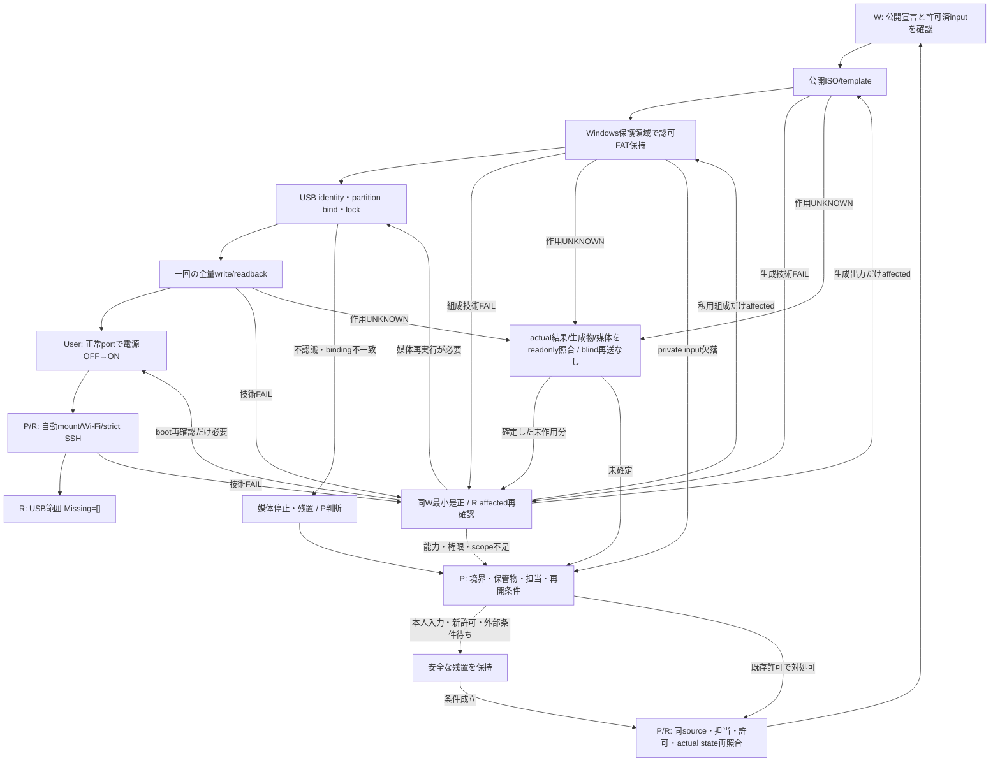

# VersaPro SSH起動USB

検証済みのNixOS live USBから、手元Linux操作なしでWi-Fi接続と固定鍵のSSH管理へ到達するためのソース。NixOS宣言を `nixos/`、Windowsの媒体writerを `windows/` に置く。[resourcesの責務案](https://github.com/roccho-dev/resources/issues/1)に沿った未公開ソースの初公開であり、既存Windows/OCI設定の移管ではない。

対象は既存のI-O DATA USB Flash Diskだけ。writerは固有serial・容量・USB型・非boot/systemを検査する。この公開は実機操作や再書込みの許可を追加しない。

## 構成と境界

```text
resources/                               # 公開S。追加はこの3ファイルだけ
├── nixos/versapro-installer.nix          # 検証済みstandalone宣言。固定nixpkgs commit
├── windows/Write-VersaProUsb.ps1         # 実USB識別・標準lock・全量書込/照合
└── docs/versapro-usb-installer.md        # 入力、実証範囲、停止/再開

Linux builder /nix/store/                 # 非秘密の再生成物
└── .../iso/versapro-ssh-installer.iso    # 公開可能なI。資格情報を含めない

G6I3の既存保護領域 / Git外              # 許可済みprivate inputの保管責任
├── wifi.env                             # Wi-Fi値。Linux builderへ送らない
├── ssh_host_ed25519_key                  # USB専用host鍵。管理client鍵とは別
└── 私用image U                          # I由来template＋既存認可FAT。公開しない

VersaPro / 起動USB
├── ISO領域                              # live system。内蔵SSDへinstallしない
└── NIXOSCONF /run/bootstrap             # vfat、ro/loop、fsckなしで自動mount

live /run/NetworkManager/system-connections/
└── bootstrap-wifi.nmconnection          # 外部入力から生成するroot:root/0600

G6I3 / 既存SSH client                    # 管理private鍵は移送しない
└── USB公開host keyの固定pin             # strict host checkingを維持
```

```text
I = Build(C, pinned nixpkgs, legacyBiosOnly=false)
T = StandardTemplate(I, empty NIXOSCONF FAT)
U = RetainAuthorizedFat(T, P_usb)          # Windows保護領域内だけで組成
MediaPASS = ExactUsbIdentity ∧ FullByteEquality(U, USB)
USB受入 = MediaPASS ∧ NormalPortColdBoot ∧ AutomaticMountWifiSsh
         ∧ StrictPinnedSsh ∧ (TargetLinuxInput=0)

P_usb ↛ Git / public ISO / Nix store / argv / public log / CI
```

`C` はこのstandalone Nix関数。既定nixpkgsは宣言内のcommit `2efa67fd26b6df417c33e4603185c701f260dd83` で、flake/lockの完成を主張しない。`P_usb` は既存認可Wi-Fi入力とUSB専用host identityを含む私用FAT。public sourceだけから秘密・私用image・失われた認証を復元できるという式ではない。媒体再作成の機能再現と、各書込みにおけるprepared image対USBの全byte一致も別の条件。

## 通常工程

1. 標準Nixで公開ISOを生成する。例えば `nix-build nixos/versapro-installer.nix --no-out-link`。秘密をbuild入力にしない。
2. 実証済み組成は、標準xorriso/mtoolsで空の非秘密FAT付きtemplateを作り、Windowsの既存保護領域で既存認可FATだけを保持する経路。私用値・FAT・imageをLinux builder、Git、storeへ送らない。初回のgeneric秘密生成/供給helperは本ソースに含まない。
3. Windowsの管理者PowerShellからwriterに私用imageと**未存在の**結果pathを明示する。例えば `pwsh -NoProfile -File windows/Write-VersaProUsb.ps1 -imagePath "<protected-stage>/prepared.img" -resultPath "<protected-stage>/fresh-result.json"`。値そのものをargvへ渡さない。個人path/dateの既定値をなくした以外、検証済みwriter coreは変更していない。
4. writerは実partitionの標準native aliasを型・disk番号・partition番号でbindし、各unique volumeをlock/dismountして保持する。実adapterの上限内・sector/page整列のdirect I/Oで全量書込と全byte比較を一度行う。過去結果の上書きや差分の許容はしない。
5. 全量一致後、UserがUSBをVersaProへ戻す。起動USBを、liveのISO/storeへ使用中に抜去・上書きしない。Wi-Fi adapterは実証された正常な本体portへ直結し、電源OFF→ON。既存管理鍵とUSB public pinによるstrict SSHで自動状態を確認する。手元Linuxコマンドを初期設定手順にしない。

元の認可private input/FATが失われた場合は、同一identityや認証の復元を保証しない。Pが保管物、必要な本人入力/新許可/再登録と再開担当を確定するまで、組成・媒体作用を進めない。

## 実証と公開ソースの対応

2026-10-11の[USB受入記録](https://github.com/roccho-dev/windows/issues/69#issuecomment-6074444170)を参照。公開installerは実build/cold boot入力と全byte同一。writerは明示path引数を使った実機検証済みcoreを保ち、今回の必須parameter headerを構文・C#compile・構造検査で確認する。公開headerから新たにUSBを書き換えたとは主張しない。

| 条件 | 実証・確認 |
|---|---|
| 生成物 | BIOS/UEFI ISO、実root closure、bootstrap ro/loop・fsck pass 0、外部Wi-Fi/host鍵の依存関係を独立確認 |
| 秘密分離 | 公開ISO/templateと私用FATを分離。認可FAT/入力の保持は内部byte比較。秘密本体/hashは公開しない |
| 媒体 | 固有USB identity、2 volume locks、実65,536-byte転送上限。1,589,706,752 bytesを書込・読戻し、差分0 |
| cold boot | 電源OFF→正常portへadapter差し直し→ONのUser報告と、P/R独立strict SSHを結合。手元Linux入力0 |
| 起動状態 | 実pg1 system、NIXOSCONFをbackingとするreadonly vfat loop、自動Wi-Fi、NM/sshd active、root600 profile |
| oneshot | ensure-profilesはCondition成功・Result=success・ExitStatus=0。完了後inactiveでも正常 |
| 本公開 | Nix全byte同値、writer core同値/headerのみ変更、3 text files、構文/C#compile、公開head/tree/readbackを独立評価 |

旧不調portのEMI等は原因確定していない。成功したport配置を使用条件にし、kernel/source変更や重複cold bootを追加していない。資格情報の非混入は上記slotのdataflow境界であり、万能secret scannerの保証ではない。

## 失敗・停止・再開



この図は対象USB工程の責任と帰着先を閉じるもので、外部条件の成功保証や本PRによるhardware操作許可ではない。書込/bootの再実行は必要な影響分だけ。結果不明を成功や作用0に読み替えない。

常設SSD、GitHub host flake/rebuild、通常回線復帰、auth/work/agent保持、Mesh、VPS評価は[先行完成設計](https://github.com/roccho-dev/windows/issues/69#issuecomment-6074206950)の未実装scope。今回のUSB受入と3ソース公開を、内蔵SSD導入・resources全体の移行・Issue全体の完了へ広げない。
