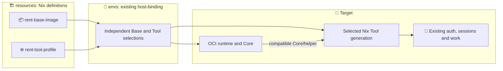
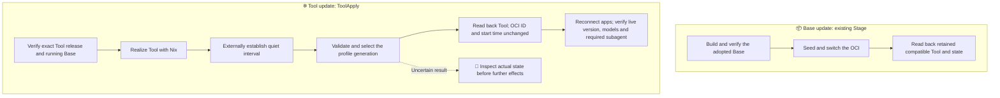

# resources

場所や端末が変わっても、積み重ねた判断を失わず、自分の意図に沿った環境で仕事を続けるために。

[提供入口・版固定・更新と復旧](docs/windows-migration-preparation.md) ／ [提供開始の現行判定・実証](https://github.com/roccho-dev/resources/pull/31)

```text
resources/
├─ flake.nix           # 全体の整合性を保つため
├─ flake.lock          # 時間が経っても同じ前提へ戻れるため
├─ profile/            # 同じ判断を繰り返す負担を減らすため
├─ nixos/              # 固有の前提を尊重し、無理な共通化を避けるため
├─ windows/            # 異なる制約の下でも、必要な使い心地を失わないため
├─ oci/                # 用途と信頼境界の違いが、互いの継続性を損なわないため
├─ extensions/         # 外部との関係の変化に、全体の判断を引きずられないため
├─ docs/               # 判断の理由を将来の自分へ残すため
└─ .github/workflows/  # 変更を信頼して受け入れる根拠を失わないため
```

共有すべき判断は一貫させ、違いが必要な場所には違いを残す。環境を作り直すことが、考え直すことの繰り返しにならないようにする。

### Standalone versa semlint owner consumer

`packages.x86_64-linux.own-semlint-versa` exposes only `ops-semlint-owner`. Its compile-time binding uses the existing own identity and the existing JEV ciphertext from envs, checks currentness and recipient through the shared launcher, builds the exact Ops `semlint-owner` package before decryption, and passes stdin to that fixed entry under a clean child environment. The only arguments are exact accepted `--envs-sha` and `--ops-sha`; no key, target or program selector is accepted.

This standalone output is not added to the default own profile, Pi, Core or Base. The compiled-binding check is not live-key validity, provider admission, G1/G2 or automatic return evidence. Real use requires a separate finite source/target/input admission; actual store, operator and provider costs remain unknown until measured.
## Independent rent Base and Tool updates

The existing Nix outputs have separate responsibilities: `rent-base-image` supplies the OCI runtime,
while `rent-tool-profile` supplies a reusable Linux Nix Tool generation. Build the latter directly with
`nix build github:roccho-dev/resources/<exact-source>#rent-tool-profile`; OCI construction is not an input.
Each output has one definition. Native reuse requires the compatible Core and existing authentication contract.

`resources` produces candidates; the existing envs host-binding selects the adopted Base and Tool;
the Target observes and applies them. A Tool selection is not a new desired-state manifest or proof of application readiness.
See [#61](https://github.com/roccho-dev/resources/issues/61),
[#60](https://github.com/roccho-dev/resources/issues/60),
[#52](https://github.com/roccho-dev/resources/issues/52), and the existing
[authentication contract](docs/own-completion.md#7-ツールprofile更新分離issue-85).



`oci/rent/win.ps1 -Step ToolApply` addresses the running B-only **`-Container`**.
After Stage, pass the adopted candidate name as `-Container`; `-Candidate` is unused by ToolApply.
`-Image` identifies its independently adopted Base; `-ToolSource` and `rent-tool.json` identify the Tool.
No paired Base release, retained old OCI, OCI restart or logon-task change is needed for this operation.
Core/helper changes remain explicit compatibility changes; this operation does not authorize changing the authentication contract.
The existing root updater still validates the exact released closure, prior generation, fixed Core helper and quiet applications.
The external controller must prevent new launches throughout selection; a process scan alone does not establish that interval.
Legacy combined-image installations need their one-time Base migration before using this entry.



Selection success reports only the selected Tool. Application readiness needs a fresh connection from the normal profile path,
with temporary PATH overrides removed. Tool recovery uses an explicitly authorized prior Tool selection after checking state-format
compatibility; it never restores work data or automatically starts the legacy OCI. Base migration recovery remains owned by Stage/Revert.
The current CI still validates and publishes the combined set of jobs; these independent Nix outputs do not imply independent CI pipelines.
