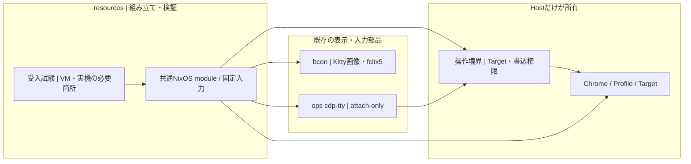
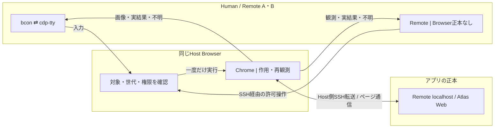
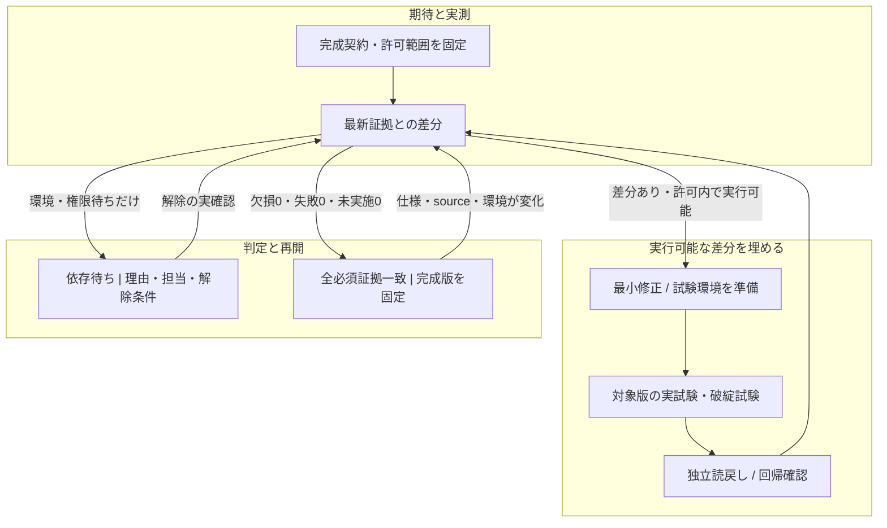

# Browser Host — 完成契約と検証閉包

**提案 / 完成未証明。** 意味・採択の正本は [ADRS #615](https://github.com/roccho-dev/adrs/issues/615)、環境の範囲は [resources #1](https://github.com/roccho-dev/resources/issues/1)。本書は完成契約を1表にまとめた実装先の投影であり、別の業務正本ではない。

## 完成状態

**Hostの唯一のHeadless Chrome/Profileを、人はbcon＋cdp-ttyで見て触り、Remote A/Bは同じ明示Targetを参照する。入力→実際の変化→表示更新まで一致し、切断・再起動でも状態を二重化しない。** Atlasは既存Web/maxGraphを使い、World/Work/Harness Sessionの意味はapps/uiに残す。Native Atlas TUIは完成条件にしない。

完成は「図・build・通信の成功」ではなく、下表の全条件に、対象版と対象環境が一致する実行証拠が揃った状態。CIの起動機能と製品の完成証明を混同しない。製品が複数プロセスを使うChromeを、OSプロセス総数1と誤定義しない。

## 構成図 — 矢印は依存

`bcon`は端末実装、Kittyはここでは画像プロトコル。別のKittyアプリやWindow Managerを追加しない。resourcesは既存ops成果物を参照し、Viewerを複製しない。共通moduleの**実装は未完**。VM専用fixtureが通っただけでは、そのmoduleや本番構成まで証明したことにしない。

**操作境界の最小契約:** 生CDPへの到達をBrowser管理側に限定し、利用者には指定Targetの観測と許可された操作だけを渡す。書込中は1主体・1作用、権限変更は未確定の作用を照合してから行う。旧権限・旧Browser世代・旧Targetへの要求は拒否する。管理操作はViewerへ混ぜない。既存opsの実行境界で実現できるかを先に調べ、迂回できる間は未達。図の箱だけで新Gateway・DB・常駐監視を増設しない。

## データフロー — 矢印は流れ

初回起動・Tabの生成/選択・Chromeの再起動はHost管理側、Viewerは明示Targetへattachするだけ。Target喪失後は古い入力を捨て、管理側で再選択する。画面の切替と書込権限の移転は別であり、送信済みか不明な操作を自動再送しない。Atlasからの指示は既存typed intent経路へ戻し、Chromeの画面を業務上の正本にしない。

## 完成を担保する唯一の検証表

V＝NixOS VMで自動実行。H＝対象ハードウェア差を隔離した実機CIで実行。まずVで実bconを試し、DRM/EGL等で成立しない試験だけHへ配置する。**試験環境を選ぶのであって、条件を削って合格にしない。** 同じ要求ID・判定を使い、別の万能テスト基盤を作らない。

| ID | 成功を示す証拠 | 破綻させる試験と期待結果 | 場所 / 修正先 |
|---|---|---|---|
| E01 再現 | 固定source・依存から共通moduleを構築しNixOS起動 | 依存不足・別moduleへの置換は拒否 | V / resources |
| E02 描画 | 実Chrome→cdp-tty→実bconの最終描画を既知画像と照合 | 空白・古い画像・画像欠損を検出。CDP画像やKitty応答だけでは不合格 | VまたはH / ops・bcon |
| E03 入力 | 仮想キー/マウス→bcon→cdp-tty→DOM値・イベント回数が一致 | wheel・drag・修飾キー・日本語変換→確定・UTF-8分割・resizeを検証。直接Input.insertTextではIMEを証明しない | VまたはH / ops・bcon |
| E04 同一性 | Remote 2台が同時に同じBrowser世代・Targetを参照 | 同じURLの別Target・曖昧な選択を拒否。Remoteの独立Browser/Profileは0 | V / resources・ops |
| E05 権限 | 1 writer、複数reader、読取側からの書込は0 | 生CDP/別Target/別メソッドの迂回・旧権限・同時writerを拒否 | V / ops・resources |
| E06 作用 | 送信1回→独立した実結果で照合 | 応答喪失・mouse-down中断・古いframe・権限移転で二重送信0。不明は不明のまま保持 | V / ops |
| E07 継続 | Viewer/SSH切断後も同じBrowser/Profileが存続 | Viewer kill、通信断、Chrome crashを区別。再起動後は認証fixtureを確認しTargetを再同定。消えたTabを保持扱いにしない | V、TTY復帰のみH / resources・ops |
| E08 Preview | Hostの既存ChromeからRemote localhostとAtlas Webが使える | 転送断・ポート衝突・古いSSEを検出。別Browserを作って迂回しない | V / resources・apps |
| E09 負荷 | 1/2/4消費者でCPU/RSS/帯域/入力遅延を計測 | slow consumer時も宣言済み上限を超えない。最大1280×720、5fps、60秒を初期測定条件とする | V、実GPU値はH / resources・ops |
| E10 隔離 | 試験用Profile・鍵・データだけで実行 | 本物の認証情報・未信頼PRの実機実行・Kitty経由のファイル参照・端末制御注入を拒否 | V/H / resources |
| E11 適用同等性 | 試験済み成果物と適用予定のuserland/moduleが一致 | VMと実機の差をハードウェア設定に限定し明示。未知GPU・boot・入力系の差はHの証拠が必要 | V＋対象H / resources |
| E12 採否 | 必須IDと実行証拠を全件照合し、欠損0・失敗0・未実施0 | 古いsource/仕様/環境・重複ID・skip・自己申告PASS・証拠改変・必要check未設定は拒否 | CI / resources |

E09のFPS等は**初期測定条件案**であって性能合格値ではない。許容CPU/RSS/帯域/p95遅延は測定前に値・単位・根拠を固定し、未固定なら完成不可。実サイト固有のSSO/WebAuthn/OSダイアログはfixtureで保証せず、使う機能を事前に宣言し必要な隔離実サイト試験をE03/E07へ加える。本物の秘密を公開CIへ渡さない。

証拠は要求ID、対象commit、仕様hash、実行環境・成果物hash、実観測、判定を持つ。`raws.jsonl`が実行記録、`disruptives.jsonl`はそこから抽出するだけ。画面の自動比較は公開可能なfixtureを使い、顧客画面は保存しない。チェックの通過だけでなく、実際のapply経路がこの採否を必須にすることもE12で確認する。

## 完成への閉包 — このグラフで進める

実行順は **E01/E04のVM入口→E02/E03の実表示・入力→E05–E08→E09–E12**。失敗はそのIDの最小修正へ戻す。環境不足も準備可能なら修正対象であり、即座に人へ投げない。独立して実行できる枝を先に進める。同一版・同一条件の失敗を無変更で無限再実行しない。

今回の指示をresourcesの設計・試験source・CI改善の継続範囲として扱い、反復ごとの再許可待ちを増やさない。実機の占有、秘密/provider/state操作、本番apply、merge、上位ADR採択は別の権限であり勝手に進めない。依存待ちは完成ではなく、解除確認→差分評価へ戻る。停止中も無人で再発火する実行器は**未接続**であり、この図だけで自動継続実装済みとは言わない。

## 実装の現在地と残り

`verification/browser-host.nix`＋同名Pythonと既存GitHub Actionsだけで、実NixOS 3台・Headless Chrome・Remote A/BのSSH参照/切断/再接続を試す入口を追加した。これはE01/E04/E07の**部分試験**であり、E02/E03のbcon・cdp-ttyを含めた完成ではない。対象ハードウェアの試験機も未接続。PRをDraftのまま維持し、実結果はPRのcommit/CI参照で報告する。

新DB・Queue・別Viewer・独自OSテストフレームワークは作らない。[ops #426](https://github.com/roccho-org/ops/pull/426)の実装と[ops #433](https://github.com/roccho-org/ops/issues/433)の実不具合を再利用する。Windows経路・envsの秘密/provider/state・Atlasの既存正本をこのPRで移管/退役しない。
