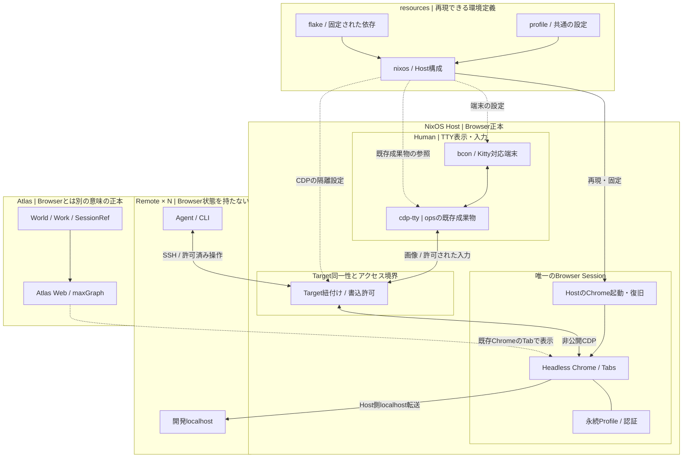
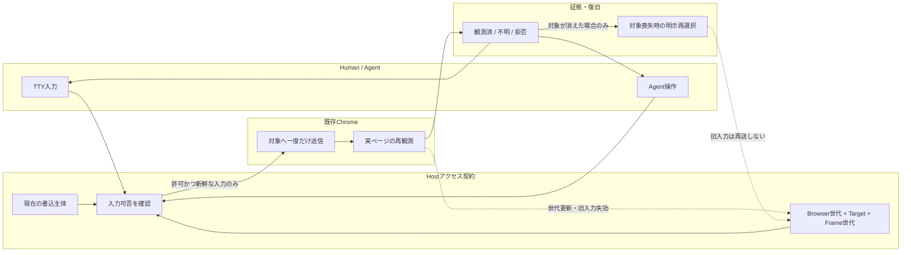
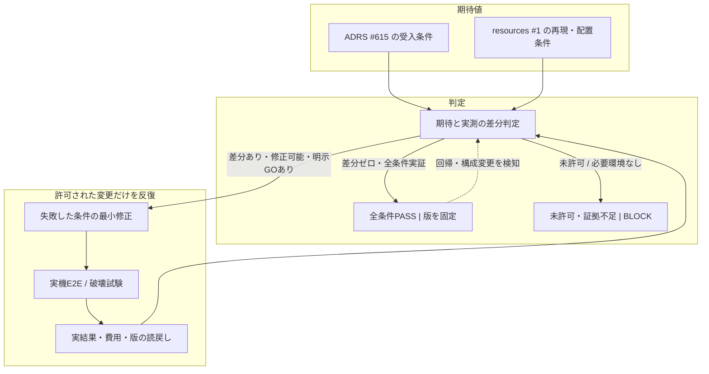

# NixOS TTY Browser Host — resources における完成状態の投影案

> **提案 / NOT_RUN。** Browser の設計・受入条件の正本は [ADRS #615](https://github.com/roccho-dev/adrs/issues/615)。本書は [resources #1](https://github.com/roccho-dev/resources/issues/1) に対して、`nixos/` で何を組み立て、何を実機で証明するかを示す。構成図を載せただけでは採択・実装・完成にならない。

## 目的と完成の定義

NixOS Host の **1つの認証済み Headless Chrome/Profile** を、人間はTTYから表示・操作し、RemoteのAgentは同じ明示Targetへ接続する。Remoteには別のBrowser認証正本を置かない。AtlasのWorld/Work/SessionはChromeのProfile/Tabとは独立した正本のまま保つ。

**完成** = 対象Host構成を固定版から再現でき、同じ実TargetでHuman/Agentの表示・入力・書込排他・観測・切断・復旧を実証し、各破壊試験の結果を読戻せた状態。Chrome再起動後のProfile保持は要求するが、消えたTabを保持できたとは主張しない。

## 完成形MMD：構成と責務

枠は**責務境界**。新しい常駐プロセスやGatewayの導入を指示するものではない。特に「Access」は未実装の**論理契約**であり、実際に迂回不能な制御を証明するまで安全性を合格にしない。

**所有を混ぜない：** `resources` はOS/ユーザー設定・Nix出力・適用検証を所有する。Browser/Viewer/入力の意味的契約はADRS #615/#423、Viewer実装は [ops PR #426](https://github.com/roccho-org/ops/pull/426)、実不具合は [ops #433](https://github.com/roccho-org/ops/issues/433)。Agent実行はops、Atlasの意味・投影はapps/ui、秘密・配置とIaC受渡しはenvsの既存責務を維持。resources #1 の `windows/`・`oci/`・`extensions/` をこの図によって退役・移管しない。

## データフローMMD：入力と読戻し

CDPの単なる送信成功を「ページ上の作用が成功」と言い換えない。同時書込は認めず、結果不明の入力を自動再送しない。

**重要な未決定：** 生CDPは接続しただけで観測専用にはならない。信頼されていないAgentへ直接CDPの権限を渡さず、すべての書込経路で排他とTarget照合を**強制**できることを示す。既存ops/SSH/OS隔離で実現できるかを先に検証し、不可能と判明した場合に限り最小の仲介を設計する。証明できなければ **BLOCK**。新Gateway/Registry/DBを先に増やさない。

## 改善閉包MMD：差分がゼロになるまで

「反復」とは無権限の自動変更を意味しない。差分が残ったまま終わる場合は **FAIL / BLOCK / NOT_RUN** を明記し、Greenや完成として閉じない。

## 受入項目 — 現時点はすべてNOT_RUN

| Gate | 実証すること | 主なowner |
|---|---|---|
| G1 再現 | exact Nix入力からNixOS Host・既存Viewer成果物を再現。適用/rollback可能 | resources |
| G2 実TTY | 物理VTでKitty画像・mouse・wheel・日本語確定文字・key・dragと端末復元が機能 | resources / ops |
| G3 Browser | Headless Chrome/ProfileはHostが所有。Viewerのattach/exitでChrome、Tab、認証、viewportを変更しない | Host / ops |
| G4 権限 | Remote A/Bは同じTargetを参照。CDP公開なし。書込主体は強制的に単一、観測専用は書込不可 | resources / ops |
| G5 復旧 | 断線・対象喪失・Chrome再起動を区別し、再同定、UNKNOWN作用、再送禁止を読戻す | Host / ops |
| G6 Preview | Host ChromeからRemote localhostに安全に到達。Atlas Webを既存Tabで利用できる | resources / apps |
| G7 性能 | 1/2/N消費主体のCPU、RSS、帯域、遅延、有限バッファ、許容値を事前に固定して実測 | resources / ops |
| G8 証拠 | revision、package closure、Host/terminal/Chrome版、実結果、復旧経路を保存。秘密や画像を公開しない | resources |

G2の既知の旧環境不具合（wheel・日本語確定入力・診断）は [ops #433](https://github.com/roccho-org/ops/issues/433) に残す。実端末での未実施を既存CIのPASSで代用しない。G4の実現方式とG7の合格閾値は**未決**であり、先に固定すること。

## 破綻試験 — これを通らなければ完成ではない

1. ViewerがChrome/Tab/Profileを追加で起動・生成する。
2. Remoteごとに認証Cookieや独立Browser正本が増える。
3. 生CDPが公開ポート経由で外部から操作できる。
4. 書込許可のないAgentがCDP入力を迂回して送れる。
5. Human/Agentが同じTabへ同時に書き込み、二重作用になる。
6. Viewer再接続時に古いTargetやFrameへ入力が届く。
7. 不明な送信結果が自動再送され、二重送信になる。
8. Chrome再起動後の消失Tabを「保持できた」と誤報する。
9. Viewer/SSH切断がChromeやProfileを破壊する。
10. 旧Nocttyで失敗したwheel・日本語確定入力を未再検証のまま合格にする。
11. slow consumerでframeバッファやRSSが無制限に増える。
12. Remote localhostへの接続のため別のBrowser Sessionを作る。
13. Browser/Profile/秘密や画面そのものを公開CI証拠へ保存する。
14. AtlasのNative TUI採用をBrowser表示の完成条件にする。

## #615 の図からの差分と禁止事項

| 変更箇所 | #615の現状 | 本提案の追加 |
|---|---|---|
| CDP経路 | Viewer/Agentが既存Chromeへ接続 | HostにTarget同一性・書込許可の**強制境界**を明示。実装方法は未決 |
| 入力結果 | 同時書込を避ける方針と受入項目 | 世代検証→一度だけ入力→実読戻し→UNKNOWN/拒否をデータフロー化 |
| 復旧 | detach/reconnectを要求 | 旧入力の失効、明示再選択、Browser世代の区別を図で可視化 |
| 再現 | ホスト構成の一般論 | resourcesのflake/profile/nixosから固定版で構築する境界を追加 |
| 完了 | 9つの実機受入項目はNOT_RUN | 実測とのgap→修正→再試験→採否の閉包を追加 |

**非作用:** この文書PRではNixOS/Chrome/SSH/CDP/secret/CI/Agent設定・コード・GitHub Issue採否を変更しない。Browserの完成条件はADRS #615でのみ採択する。Windowsの既存復旧経路、envsのprovider/state、Atlas Webを退役させない。
