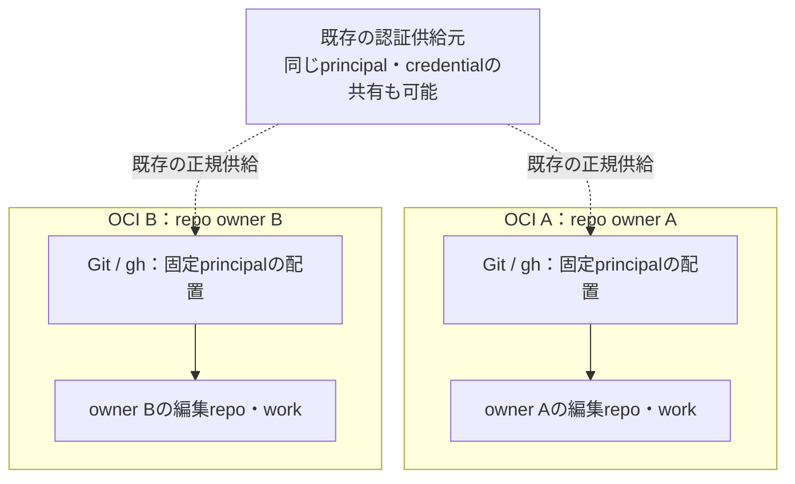

# OCIごとにrepo ownerを分離する案

状態: **提案・未採択**。2026-10-13時点の既存実装を確認したうえで、repoごとの認証選択をOCIの配置から簡単にできるか検討する。文書とDraft PRの提示までを対象とし、実装の削除、OCI作成・切替、認証の複写・更新、実機適用は含めない。

## 目的と用語

**一つのOCIで編集・公開するrepoのGitHub owner namespaceを一つに固定する。別ownerの作業は、そのownerを宣言した別OCIで行う。認証は必要に応じて共有できる。**

ここでrepo ownerは `https://github.com/<owner>/<repo>` の `<owner>`（UserまたはOrganization）を指す。POSIXのファイルowner、OCI内のUID、認証したGitHub accountとは別である。

| 区分 | 意味 | 一致が必要か |
|---|---|---|
| repo owner | 編集・公開対象repoのnamespace | 一つのOCIで一つに固定 |
| 認証principal | GitHubが認証したaccount | repo ownerとの一致は不要 |
| credential参照 | 既存の正規供給元と対象での資格情報配置 | 複数OCIで同じ供給元を参照してよい |
| OCI instance / own・rent・dev | 配置先と用途・信頼境界 | ownerとは別軸。同じownerのOCIが複数あってよい |
| POSIX owner / UID | repo・設定・永続状態を操作するOS主体 | 現行の所有権検査を別に維持 |

たとえば同じ `mti-takasawa` accountが二つのOrganizationに権限を持つ場合、各Organizationの作業OCIを分けても認証principalは同じでよい。これは配置例であり、そのaccountの現在の権限や資格情報共有の許可を表さない。

## 必須条件だった既存実装の確認

「gh、git側の工夫でowner検知させる実装」が見つからなければ提案作業を中断する条件を、以下の**現存する実コード**で確認した。履歴PRの説明だけを根拠にしていない。

確認したwindowsの `proposals` は commit **`df42ac09cd7a2e25630662c7b08e8f65f88a50fa`**。Pと同じモデル・effortを継承した独立subagentが同じ版を実読した。これはsourceの現存確認であり、現在稼働するOCIへその版が適用されている証拠ではない。

| exact source | 確認した動作 |
|---|---|
| [hosts/profile/gh.nix L1–26](https://github.com/roccho-dev/windows/blob/df42ac09cd7a2e25630662c7b08e8f65f88a50fa/hosts/profile/gh.nix#L1-L26) | 同じprofileで複数namespace/principalを扱う。`owner` 引数はstable helper名を決めるだけで、namespace・principal・slotを選ばない |
| [gh.nix L39–138](https://github.com/roccho-dev/windows/blob/df42ac09cd7a2e25630662c7b08e8f65f88a50fa/hosts/profile/gh.nix#L39-L138) | repoのcommon-dir設定・POSIX所有権・九設定・正規URL・stable helperを検査し、宣言principalの `/work/repos/.auth/<principal>/gh` を選択。native ghの応答を照合する |
| [gh.nix L140–210](https://github.com/roccho-dev/windows/blob/df42ac09cd7a2e25630662c7b08e8f65f88a50fa/hosts/profile/gh.nix#L140-L210) | `bind REPO URL PRINCIPAL` が九設定を設定・読戻し。衝突は変更前拒否、再実行はno-op、既知失敗は自分が変更した設定だけ条件付き復元 |
| [gh.nix L211–260](https://github.com/roccho-dev/windows/blob/df42ac09cd7a2e25630662c7b08e8f65f88a50fa/hosts/profile/gh.nix#L211-L260) | Git helperのgetはexact repo path/principalに限定。store/eraseはno-op。gh wrapperは未選択時に `/proc/gh-unselected` を使い、token・targetの環境変数とambient keyring経路を抑制 |
| [hosts/profile/nix.nix](https://github.com/roccho-dev/windows/blob/df42ac09cd7a2e25630662c7b08e8f65f88a50fa/hosts/profile/nix.nix) / [oci/dev/nix.nix](https://github.com/roccho-dev/windows/blob/df42ac09cd7a2e25630662c7b08e8f65f88a50fa/oci/dev/nix.nix) | 共通profileとdevが同じgh定義を利用。devはSpecの明示 `githubPrincipal` をbindingへ渡す |
| [oci/dev/proof.sh L1012–1135](https://github.com/roccho-dev/windows/blob/df42ac09cd7a2e25630662c7b08e8f65f88a50fa/oci/dev/proof.sh#L1012-L1135) | production helper/bindを使う既存fixtureと、未binding・不完全bindingの別owner fixture・上書き入力・旧helperの無作用成功を拒否する検証が残る。正常bindingされた別namespaceを一律拒否する実装ではない |

経緯は [windows PR42](https://github.com/roccho-dev/windows/pull/42)、[PR50](https://github.com/roccho-dev/windows/pull/50)、現在の要件は [windows #8](https://github.com/roccho-dev/windows/issues/8)。既存コードはtokenからownerを推定する実装ではなく、**repoに宣言されたURLとprincipalを検査して認証を選ぶ実装**である。設定されたactive accountの照合と、GitHub側の実principal・必要repo権限の実確認も区別されている。

Git helperのexact path制約とghの操作先制約は同じではない。現gh wrapperはcwdからslotを選び、`-R`/`--hostname`でslotを変更させず、引数をnative ghへ渡す。共有credentialに別ownerへの権限があれば、選択されたslotでその別ownerを操作できる可能性は残る。現実装が全ての別owner操作を拒否しているとは主張しない。

同じsourceの [push CI run 38331056311](https://github.com/roccho-dev/windows/actions/runs/38331056311) は成功し、[own build-test](https://github.com/roccho-dev/windows/actions/runs/38331056311/job/115080667140) と [rent build-test-publish](https://github.com/roccho-dev/windows/actions/runs/38331056311/job/115080667221) の既存検証も成功している。これはsource/fixture側の証拠であり、実tokenの有効性、現在のprovider権限、稼働OCIの適用版の証明には使わない。

## 同じ問題を配置から解く

現行方式は、一つのOCIに複数owner/principalのrepoがある前提で、実行ごとにrepo-local宣言から選択する。案では、その可変部分をOCIの起動・配置時に固定する。

1. OCIの非秘密宣言に、対象namespaceと期待principalを別々に固定する。既存Binding/Specと合成入口に接続し、別のowner registryや認証台帳を作らない。
2. repoの配置・cloneと作業担当の選択で対象URLがそのnamespaceに属することを確認する。別ownerの編集・公開は別OCIへ移る。callerの `-R`、API URL、push URL等で別対象を指定しても、作業scopeの追加許可にはならない。この運用上の割当だけを、native ghの全操作先を技術的に拒否する仕組みとは扱わない。
3. 同じOCIではrepoごとのprincipal切替を要求しない。Git/ghの標準設定を第一候補として、既存の動的選択・九設定・bind/復元処理のうち、実際に不要にできる部分を検証してから整理する。
4. HOME・work・native session等の書込み状態はinstanceの既存永続境界に置く。別ownerの編集可能workを同じmountへ混在させず、同じ永続対象のactive writerは一つにする。既存volumeの一括改名や移動を先行条件にしない。

ownerごとの専用image再buildは要求しない。共通image/profileを再利用し、instanceの非秘密入力とwork配置でcontextを分ける。現resourcesの [own-oci.nix（確認版）](https://github.com/roccho-dev/resources/blob/0017b634d83f1949d612fffdee317739be61b292/nixos/own-oci.nix) はcontainerNameから三つのvolume名を作るが、repo ownerの宣言・検査や複数ownerの受入はまだ実装していない。

固定された外部Nix inputsやupstream依存の取得は、編集・公開するrepoのownerとは分ける。公開固定sourceは依存入力として参照できる。別namespaceのprivate repoや書込み可能なsupport cloneを必要とする場合、そのアクセス主体・用途を明示して別OCIとの受渡しを設計する。暗黙の複数owner作業へ戻す例外にしない。

## 認証を共有する場合の補足

**repo ownerの分離は、認証account・tokenの分離を必須にしない。** 同じprincipalが複数ownerに必要な権限を持つなら、既存の認可された供給・配置経路で複数OCIに同じ認証を供給できる。共有の可否・対象・更新/失効の担当は認証供給側で決める。

共有とは、資格情報の供給元を共有できるという意味であり、複数OCIでmutableなgh設定/HOMEを同時に書き換えることを要求しない。通常の認証更新・native設定の書込み領域は対象別に扱い、共有書込みが必要なら単一writerの担当を明示する。既存slotの `<principal>` をrepo namespaceへ機械的に改名しない。

この場合、一方のOCIから見えるcredentialに別ownerへの権限が残り得る。OCIを分けただけでGitHub側の権限が縮小したことにはならず、root・同UID・host管理者に対する秘密隔離も主張しない。provider側で権限分離が必要なscopeは別credential/権限設計を必要とする。

実principal・必要repo操作の権限は、供給・更新・復旧時にproviderから確認する。owner文字列、配置先名、native account metadata、fixtureの成功をその証拠の代わりにしない。既存認証の自動複写・再login・rotationや新brokerを、この案の保存で開始しない。

## 簡単になるものと残すもの

| 論点 | 現行repo単位方式 | OCI単位案 |
|---|---|---|
| 通常の認証選択 | repo-local URL/principalから毎回選択 | OCIの宣言から固定。repoは対象namespaceとの一致を確認 |
| 複数owner作業 | 一つのprofileで切替可能 | ownerごとに作業OCIを選ぶ。切替の運用費用を実測する |
| 初回binding/復元 | 九設定、衝突拒否、部分書込み復元 | 動的bindingの削減候補。実際の不要部分を有限比較で確定 |
| 認証共有 | principal-qualified slot | 共有可。repo ownerとprincipalを別に保つ |
| 未選択・別対象への拒否 | helperのexact Git path、wrapperのslot選択に制約。gh全操作先の制限はない | 現行の必要な拒否を維持。操作先の追加制限を導入するなら別に目的・実装・証拠を定める |
| 実認証・継続・復旧 | provider readbackと実機証拠 | 同じ責務を保持。初回、通常更新、失効/喪失を区別 |

標準の [gh auth setup-git](https://cli.github.com/manual/gh_auth_setup-git) はGitへcredential helperを設定するが、選択単位はhostであり、このowner境界の証明にはならない。[Git credential context](https://git-scm.com/docs/gitcredentials) と [ghの環境変数](https://cli.github.com/manual/gh_help_environment) の標準動作を使える範囲を先に確かめる。`useHttpPath`だけでownerアクセスを拒否できるとは扱わない。

既存wrapperを全て残したままowner別OCIを追加するだけなら、構成が増えるため簡素化とは言えない。一方、OCI配置だけを理由に未bindingからの認証fallbackやGit helperのexact path検査を消すことも同等の代替にはならない。評価対象はコード、設定、永続物、権限、操作分岐とOCI切替費用の総量とする。

全CLI/APIで別ownerへの作用を技術的に禁止することが必要なら、共有認証の実provider権限を含めた別の受入条件とする。任意のgh引数/APIを解釈する新wrapperを本案の暗黙の必須実装にせず、provider標準の権限設定で満たせるかを先に確認する。

## 採用判断に必要な有限比較

文書の妥当性と、運用方式の採用・実装・実機受入を分ける。後続の実装比較は、別途scopeと作用を定めた小さな一組で行う。

| 比較 | 必要な証拠 |
|---|---|
| 一つのownerの二repo | 同じOCI/principalで通常Git・gh操作が成立し、repoごとのprincipal切替が不要 |
| 二つのownerと共有principal | 各OCIの対象ownerは固定したまま、両者の正規認証が成立。accountとnamespaceの同一視がない |
| 新OCIのowner割当 | 配置repoのnamespaceがOCIの宣言と一致。不一致は配置・担当選択で拒否する。これは現行の複数namespace対応に追加する配置条件 |
| 現行拒否との互換 | repo宣言と異なるGit path要求、不完全binding、未選択・未配置認証、環境変数・別helper・include/redirect・push URLの衝突を比較し、必要なGit/slot拒否を弱めない。失効は実provider拒否として別に確認 |
| 操作先と権限の限界 | `-R`/API targetによる別owner指定を観測し、共有認証で可能な作用と作業scopeを区別。現行にない全target拒否を達成済みとしない |
| 再作成・更新・復旧 | repo/work/native sessionと有効認証の保持、認証喪失時の正規復旧、同じ永続対象のwriter重複0 |
| 簡素化 | 消せる既存処理と必要な最小拒否境界を実差分で示し、追加OCI・状態・操作費用を含めて比較 |

まず秘密不要のfixtureで対象選択と拒否を比較し、必要な実認証・対象操作はその時点の許可で別に確認する。現行の必要な拒否・継続性を維持できない、または運用総量が減らない場合は置換を採用しない。runtimeの更新や旧実装の削除は採用判断後の別工程とする。

## resourcesとの接続

[resources #1](https://github.com/roccho-dev/resources/issues/1) のOCI用途・信頼境界と共通profileの責務へ、このowner軸を追加する案である。[resources #10](https://github.com/roccho-dev/resources/issues/10) の同OCI Codex/Pi完成条件や現在の実機・認証残件は別に保持する。GitHub authのsourceは現在windowsにあり、resourcesへコピーして第二正本を作らない。

既存の実行規約は [ADRS execution（確認版）](https://github.com/roccho-dev/adrs/blob/6e7635aa16db09ee55b60e8ff1f697f97b5c0ab9/policy/execution.md#git-and-repository-authority) にある。repo-local選択を実運用で置換するには、採用するsourceと規約・consumerを同じ境界へ整列する。この提案の公開・mergeだけで既存GO、認証配置、稼働OCIを変更しない。
