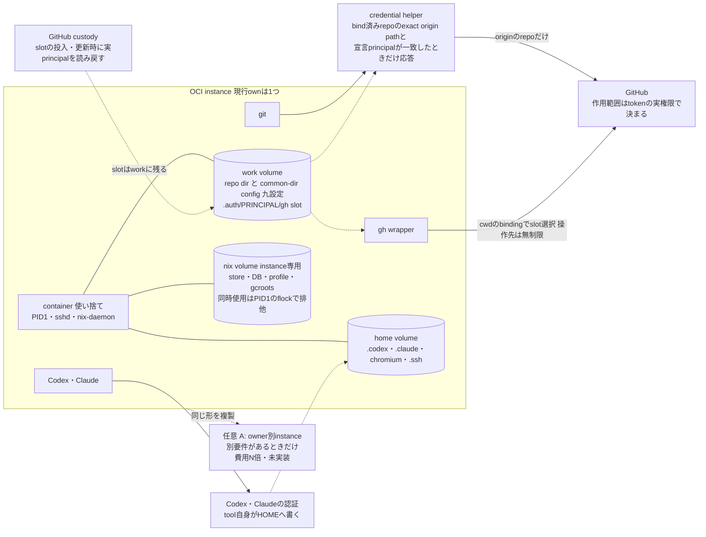

# OCIごとにrepo ownerを分離する案：評価と最終推奨

状態: **提案の最終版・未採択**（2026-10-14）。2026-10-13版（`8c35f893`）の「OCIごとにownerを分ける案」を、既存実装・総量・制約で評価し直した。文書とDraft PRまでが対象で、実装・OCI作成/切替・認証の複写/更新・実機適用は含まない。

## 結論

**現行のrepo単位の認証選択を置き換えない。OCIごとのowner分離は、総量を減らさないため採用を推奨しない。**

判断基準は旧版自身が定めた採用条件である。「現行の必要な拒否・継続性を維持できない、または運用総量が減らない場合は置換を採用しない」。

- owner別OCI（下表A）は、現行の動的選択（bind・pick・answer・九設定）を**一つも消さない**。instance・volume・slot・custody・宣言fieldと検査を**足すだけ**の配置規則にとどまる。
- 動的選択を実際に消す「instance固定slot」（下表B）は総量を減らし得る。ただし拒否の単位がexact repoからnamespaceへ弱まる。この保証変更にはP/Userの判断が要り、未実証である。
- 全client共通のNix storeは採らず、instanceごとの/nixを維持する（保留。再開条件は後述）。

Aは、作業workをownerごとに分ける**別の要件**が出たときだけ、下記の費用と制約を承知で選べる配置案として残す。

## Userの期待と回答

| 期待・問い | 回答 | 根拠 |
|---|---|---|
| OCIの配置でrepoごとの認証選択を簡単にできるか | できない。owner別OCIは追加になり、選択処理は残る | §総量比較 |
| git/ghは不要になるか | ならない。git・gh wrapper・credential helperは共通profileに残る | [profile/nix.nix L49–53](https://github.com/roccho-dev/windows/blob/df42ac09cd7a2e25630662c7b08e8f65f88a50fa/hosts/profile/nix.nix#L49-L53) |
| principalとcontainer/volumeの関係 | containerは使い捨てで認証を持たない。GitHub認証はwork volume上のslot、Codex/Claudeの認証はHOME側にある | §用語、§状態表 |
| クライアントごとの実体と認証 | 実体の単位はinstance（container＋home/work/nix）。その中で複数のtool clientが動き、認証の置き場とwriterはtoolごとに違う | §状態表 |
| volumeは分けたほうがよいか | 寿命・lock・信頼境界・再生成可能性のどれかが違えば分け、同じならdirectory。ownの3 volumeは妥当 | §volume基準 |
| 全client共通のNix store volume | 採らない（保留）。instanceごとの/nixを維持し、容量の重複を代償とする | §共通store |

## 既存実装の確認

確認版は windows `df42ac09`（tree `d0f89a75`）。resourcesのflakeが固定するwindowsは `d8e980b3`（[flake.nix L5](https://github.com/roccho-dev/resources/blob/0017b634d83f1949d612fffdee317739be61b292/nixos/flake.nix#L5)）で、treeは同じ `d0f89a75` である。sourceの存在確認であり、稼働OCIの適用版やproviderの実principalの証拠ではない。

| source | 動作 |
|---|---|
| [gh.nix L1–26](https://github.com/roccho-dev/windows/blob/df42ac09cd7a2e25630662c7b08e8f65f88a50fa/hosts/profile/gh.nix#L1-L26) | repoのcommon-dir configが唯一の宣言。origin `https://github.com/<namespace>/<repo>` と `credential.<URL>.username`（期待principal）。namespaceとprincipalは一致不要 |
| [gh.nix L74–79](https://github.com/roccho-dev/windows/blob/df42ac09cd7a2e25630662c7b08e8f65f88a50fa/hosts/profile/gh.nix#L74-L79) | 九設定: helper reset、URL/URL.gitのhelperとusername、useHttpPath、followRedirects=false、origin・pushurl |
| [gh.nix L81–134](https://github.com/roccho-dev/windows/blob/df42ac09cd7a2e25630662c7b08e8f65f88a50fa/hosts/profile/gh.nix#L81-L134) | pick: 九設定と所有権を読み、`/work/repos/.auth/<principal>/gh` slotの実在と形式を確認する。answer: native ghに宣言principalで問い合わせ、一致したときだけ応答する |
| [gh.nix L136–206](https://github.com/roccho-dev/windows/blob/df42ac09cd7a2e25630662c7b08e8f65f88a50fa/hosts/profile/gh.nix#L136-L206) | `bind REPO URL PRINCIPAL`: 九設定を書く。衝突は書く前に拒否、再実行はno-op、既知失敗は自分の書込みだけ復元 |
| [gh.nix L213–258](https://github.com/roccho-dev/windows/blob/df42ac09cd7a2e25630662c7b08e8f65f88a50fa/hosts/profile/gh.nix#L213-L258) | helperのgetはexact origin pathと宣言principalに限る。gh wrapperはcwdのbindingでslotを選ぶが、`-R`・`gh api` の操作先は制限しない |
| [own nix.nix L252–254](https://github.com/roccho-dev/windows/blob/df42ac09cd7a2e25630662c7b08e8f65f88a50fa/hosts/own/nix.nix#L252-L254) | system/global Git設定を読まない。認証はrepoのbindingからだけ来る |
| [oci/dev/proof.sh L1012–1135](https://github.com/roccho-dev/windows/blob/df42ac09cd7a2e25630662c7b08e8f65f88a50fa/oci/dev/proof.sh#L1012-L1135) | 未binding・不完全binding・上書き入力・旧helperの拒否fixture |

既存コードはtokenからownerを推定せず、**repoに宣言されたURLとprincipalを検査して認証を選ぶ**。経緯は [windows PR42](https://github.com/roccho-dev/windows/pull/42)、[PR50](https://github.com/roccho-dev/windows/pull/50)、[windows #8](https://github.com/roccho-dev/windows/issues/8)。

## 用語（混同しない6つ）

| 用語 | 意味 | 現行／提案 |
|---|---|---|
| Binding.owner | helper名 `git-credential-github-<owner>` だけを決める既存field（[G6I3.json](https://github.com/roccho-dev/windows/blob/df42ac09cd7a2e25630662c7b08e8f65f88a50fa/hosts/own/bindings/G6I3.json)、gh.nix L25–26） | 現行。意味は変えない |
| repoOwner | instanceが扱うrepoのnamespace | 提案（Aを選ぶ場合だけ）。未実装 |
| expectedPrincipal | repo configの `credential.<URL>.username`。Aではinstanceに一つ | repo単位は現行、instance単位は提案 |
| providerの実principal | tokenをGitHubが認証したaccount。custody時に同じslotから `gh api user` を読み戻したときだけ確認できる（gh.nix L16–23） | 選択処理は証明しない |
| OCI instance | container名・home/work/nix volume・host port・管理鍵・image（Aでは＋2 field）の組 | ownは現行。resourcesのhost moduleは単一instanceで、複数instance化は未実装・未計画 |
| tool client | instance内で動くgit・gh・Codex・Claude・Chromiumのprocess | 一つのinstanceに複数 |

slot pathの表記は、ADRS policyが `.auth/<github-owner>/gh`、gh.nixのcodeが `<principal>`（L102）。本書はcodeに従う。揃えるかどうかは別のP判断である。

## instance内の状態・認証・writer・寿命

| 状態 | own（home/work/nix volume） | rent | writer |
|---|---|---|---|
| GitHub認証（git/gh） | work `/work/repos/.auth/<principal>/gh` | 同じ | custody（個別許可のlogin・refresh・copy）だけ。選択処理は読むだけ |
| repo・Git binding | work内のrepo dirとcommon-dir config | 同じ | bind（一度）と作業者 |
| Codex認証・session | HOME `~/.codex`（tool既定。HOME全体がvolume） | state volumeへのlink（[flake.nix L338–365](https://github.com/roccho-dev/windows/blob/df42ac09cd7a2e25630662c7b08e8f65f88a50fa/flake.nix#L338-L365)）。import対象は `auth.json`（L164） | Codex自身 |
| Claude認証・session | HOME `~/.claude`・`~/.claude.json` | 同上。`.credentials.json`、`projects/
/<id>`（L162–163） | Claude自身 |
| Chromium profile | `home/chromium/p1..3`（[own L114](https://github.com/roccho-dev/windows/blob/df42ac09cd7a2e25630662c7b08e8f65f88a50fa/hosts/own/nix.nix#L114)）。合成試験用で実loginはしない（L103） | なし | Chromium |
| SSH鍵・host key | `home/.ssh`（own L170–183） | `$state/ssh` | PID1（初回） |
| Nix closure・profile・gcroots | nix（own L153–163） | 同じ | seedとdaemon |
| その他HOME | home volume（永続） | 使い捨て（毎回新規） | 各tool |

containerは使い捨て（`autoRemoveOnStop`）で、上の状態はすべてvolume側に残る。GitHub認証とCodex/Claude認証は別の供給・custody経路であり、本提案の選択処理はGitHub側だけを扱う。Codex/Claudeのprovider・保存形式は本書の対象外とし、推定しない。

## volumeを分ける基準

寿命・lock・信頼境界・再生成可能性のいずれかが違えば別volume、全部同じならdirectoryにする。

- ownが排他lockを取るのは /nix だけ（[own L153–155](https://github.com/roccho-dev/windows/blob/df42ac09cd7a2e25630662c7b08e8f65f88a50fa/hosts/own/nix.nix#L153-L155)、seed L215–216）。home・workは名前とrwの検査（L147–152）だけで、排他はない。rentは3つともlockを取る（[flake.nix L303–309](https://github.com/roccho-dev/windows/blob/df42ac09cd7a2e25630662c7b08e8f65f88a50fa/flake.nix#L303-L309)）。
- flockは協調的で、lockを取らないwriterは止まらない（同L303–305の注記）。
- markerの `windows-own-nix v1` は役割の印でinstanceを識別しない。停止中instanceのnixを別instanceへ付け替えると、現行では受け入れられる。

## 総量比較と判定

記号: N＝扱うowner数、R＝repo数、P＝使うprincipal数。現行はown 1 instanceを想定する。

| 項目 | 現行（repo単位選択） | A: owner別OCI（配置規則を追加） | B: instance固定slot（選択を置換） |
|---|---|---|---|
| instance／volume | 1／3 | N／3N | N／3N |
| GitHub slot（custody対象） | P | N（各instanceのworkに期待principalのslotだけ） | N |
| repoごとのbind・九設定 | R回・9R設定 | R回・9R設定（変わらない） | 0 |
| code: bind・pick・answer | 残る | **すべて残る** | bind・九設定は削除。pick・answerはinstance単位の固定設定に置換（新規） |
| 追加code/config | なし | host moduleの複数instance化、`repoOwner`・`expectedPrincipal`、bind時の検査K1・K2 | 同左のmoduleとfield、instance単位のGit/gh設定生成、namespace検査付きhelper |
| 運用 | 1 instanceで全owner | owner切替＝instance切替。port・鍵・custodyがN倍 | 同左 |
| 拒否の単位 | exact repo（bind済みoriginだけ） | exact repo＋配置規則 | namespace（同owner内の未bind repoにも認証が出る） |
| Nix容量 | closure×1 | closure×N（seedの `cp -a`、[own L233–239](https://github.com/roccho-dev/windows/blob/df42ac09cd7a2e25630662c7b08e8f65f88a50fa/hosts/own/nix.nix#L233-L239)） | closure×N |
| 判定 | 基準 | **純増。削れるものがない** | 削減し得るが、**保証が弱まり未実証** |

例: N=2、R=6、P=1 のとき、現行は instance 1・slot 1・bind 6 回。Aは instance 2・slot 2・bind 6 回に、検査とmoduleが加わる。Bは instance 2・slot 2・bind 0 回だが、同じownerの任意repoへ認証が出る。

**判定**: Aは現行の選択処理を置き換えず、上に積むだけである。旧版の基準では採用しない。Bは、own構成の「system/global Git設定を読まず、認証はrepoのbindingからだけ来る」という既存の保証（own L252–254）を変える。採るなら、P/Userがこの保証変更を承認し、未binding拒否をnamespace単位で再設計・実測してからになる。本書はBを推奨しない。現時点で実測された必要性がないためである。

## 完成状態

**図の読み方**:
- 実線のnode（instance、3 volume、helper、gh wrapper）は現行sourceにあるもの、`OPT` だけが提案で未実装である。
- containerは使い捨てで認証を持たない。GitHub認証はworkのslotに、Codex・Claudeの認証はhomeにあり、containerを作り直しても残る。
- Gitはhelperを通り、bind済みrepoのoriginにだけ認証が出る。gh wrapperはcwdのbindingでslotを選ぶが、`-R` や `gh api` の操作先は制限しない。どちらも、GitHub上で何ができるかはtokenの実権限で決まる。**ownerの配置は権限のfenceではない。**
- 選択処理は宣言を読むだけで、providerの実principalは証明しない。実principalはcustody時の読み戻しでだけ確認する。
- nixはinstanceごとに一つで、共通storeは置かない（後述）。

## 認証を共有する場合

認証の**供給元**は複数instanceで共有してよい。ただしslotはinstanceごとのworkにあり、slotごとにwriterは一つである。slotへのcopy・import・追加loginはそれぞれ個別に許可されたcustody行為なので（gh.nix L18–23）、同じprincipalを使うinstanceがN個あれば、初回投入・refresh・失効の作業もN倍になる。共有auth volumeは、ownの「volumeは正確に3本」という検査（own L152）に反するので置かない。

## 全client共通のNix store

**現状の推奨は、instanceごとの/nixである。** 理由は次の3つ。

1. 現行sourceでは、own PID1が/nix volume rootに排他lockを取り、seedも同じlockを取る（own L153–155、L215–216）。2つ目のcontainerは同時に使えない。
2. Nixは `trusted-users = root`、`sandbox = false` で動く（[flake.nix L57–63](https://github.com/roccho-dev/windows/blob/df42ac09cd7a2e25630662c7b08e8f65f88a50fa/flake.nix#L57-L63)）。clientのuid0はdaemonからもrootに見えるので、共有すると全clientのrootの和集合が信頼境界になる。own・rentの間での共有は不可。
3. NixOS/nix 2.18.0の `src/libstore/gc.cc` の記述では、runtime rootは自分のPID namespaceの `/proc` だけを走査し、`gcroots/auto` の壊れたlinkはGC時に削除する。temporary rootは `temproots/<pid>` という名前である。imageの実際のNix版は観測していない。

共有が原理的に不可能だという主張ではない。再開する場合は、次の条件をすべて設計に入れたうえでPが判断し、実際のNix版でV3に合格することを条件とする。

| 要素 | 条件 |
|---|---|
| controller | 専用のdaemon一つが、store・DB（`/nix/var/nix/db`）の唯一のwriterになる。clientは `NIX_REMOTE=daemon` でsocketに接続するだけ |
| clientのmount | /nixはread-onlyにする。rwでmountしない（rwならdaemonを通らずに書ける） |
| 信頼 | clientのrootをtrustedにしない（user namespaceの再割当てか、clientを非rootで動かす）。同じ信頼境界のinstanceだけで共有する |
| profile・gcroots名 | instanceごとに分ける（例: `profiles/<instance>`、`gcroots/<instance>`）。現行の `own-dev`・`gcroots/own` は固定名なので衝突する |
| 間接root | clientの `result` などを、daemonから同じpathで見えるようにするか、controllerへ明示登録する。同じcontainer内なら作業のout-linkがGC後も残ることは、rentのproofで確認されている（[rent proof.sh L219–225](https://github.com/roccho-dev/windows/blob/df42ac09cd7a2e25630662c7b08e8f65f88a50fa/hosts/rent/proof.sh#L219-L225)） |
| 実行中のclosure | PID namespaceをまたいで見えないので、各instanceのclosureを明示的なgcrootで固定する |
| GC | controllerだけが実行する。影響は全clientに及ぶ |
| 寿命と復旧 | controllerが最初に起動し、最後に止まる。controllerやDBの障害は全instanceを止める。seedとupgradeはcontroller経由に作り直す |
| 容量 | closure×instance数の重複が消える。代わりに、単一障害点と信頼境界の縮小を受け入れる |

## 受入fixtureと不変条件

すべて将来の実装phaseで行う。「現行」は現在のcodeで成り立つべきもの、「提案」はAを選んだ場合だけのもの、「制約」は拒否されないことを観測して記録するもの。

| # | 状況 | 期待 | 区分 |
|---|---|---|---|
| F4 | 未binding・不完全binding・上書き入力 | 拒否される（既存proof.sh）。どの案でも弱めない | 現行 |
| V1a | 稼働中instanceのnixを別instanceが使う | flockで拒否 | 現行 |
| F6 | `gh -R`・`gh api` で別ownerを指定 | 拒否されない | 制約 |
| F7 | bind後にoriginと九設定を一貫して別namespaceへ書き換える | Gitは通る | 制約 |
| V1b | 停止中instanceのnixや同じworkを別instanceが使う | 受け入れられる | 制約 |
| F1 | namespaceとusernameがどちらも一致 | bindが成立し、helperが応答する | 提案 |
| F2 | namespaceが `repoOwner` と不一致 | bindを拒否し、configは変わらない | 提案 |
| F3 | usernameが `expectedPrincipal` と不一致 | bindを拒否し、configは変わらない | 提案 |
| F3b | bind後にusernameを別principalへ書き換える | instanceのworkには `expectedPrincipal` のslotしか置かないので、選択されない | 提案 |
| F5 | `Binding.owner` と `repoOwner` が違う値 | F1が成立する（2つのfieldは独立） | 提案 |
| V1 | host module複数instance化の後 | volume 6本、port・鍵が2組 | 提案 |

## 制約

- ownerの配置は権限のfenceではない。GitHub上の権限分離が必要なら、別credentialと権限の設計が要る。
- 同じUIDやrootからの隔離は主張しない。slot・宣言・configは同じUIDが書き換えられる。F3bの保証は、規律と事後の確認によるものである。
- flockは協調的で、停止中のvolumeのinstance識別もない。
- providerの実principal、slotの継続、Nixの実版、volumeの実容量は観測していない。

## ブラインド比較

本書はADRS PR #636で、独立したR（評価者）とW（作成者）が主張と反証を往復した結果を統合したものである。結論の根拠は本書の参照sourceだけで足り、コメントは経緯の記録にすぎない。

| 区分 | 内容 |
|---|---|
| Rの独立初期結論 | 4軸（owner・principal・instance・volume）を分ける、instanceは3 volume、共通/nixは推奨しない。Wの結論と独立に一致した |
| Wの自己訂正 | ownのlockは/nixだけで、home・workに排他はない（当初は全volumeにlockがあると読んでいた）。local-storeのread-only警告は根拠から外した |
| Rが加えた反例 | 共通storeでのGC root・runtime root・rw mount・uid0の問題。host moduleが単一instanceであること。bind後のusername書換え。停止中volumeの付替え。`gh -R`。`Binding.owner` を流用しないこと。Nixの根拠は2.18.0のsourceに限られること |
| 今回の再評価 | 総量比較により、owner別OCIは置換ではなく追加であると判定した |

## resourcesとの接続

[resources #1](https://github.com/roccho-dev/resources/issues/1) のOCI用途・信頼境界の議論に、owner軸を評価した結果として本書を加える。[resources #10](https://github.com/roccho-dev/resources/issues/10) の同OCI Codex/Pi完成条件や、現在の実機・認証の残件は別に扱う。GitHub認証のsourceはwindowsにあり、resourcesへコピーして第二の正本を作らない。

既存の実行規約は [ADRS execution（確認版）](https://github.com/roccho-dev/adrs/blob/6e7635aa16db09ee55b60e8ff1f697f97b5c0ab9/policy/execution.md#git-and-repository-authority) にある。本書の公開・mergeは、既存のGO、認証の配置、稼働中のOCIを何も変更しない。実装（host moduleの複数instance化、fieldと検査の追加、共通storeの再開）と採否は、別のP判断とUserの採用による。
