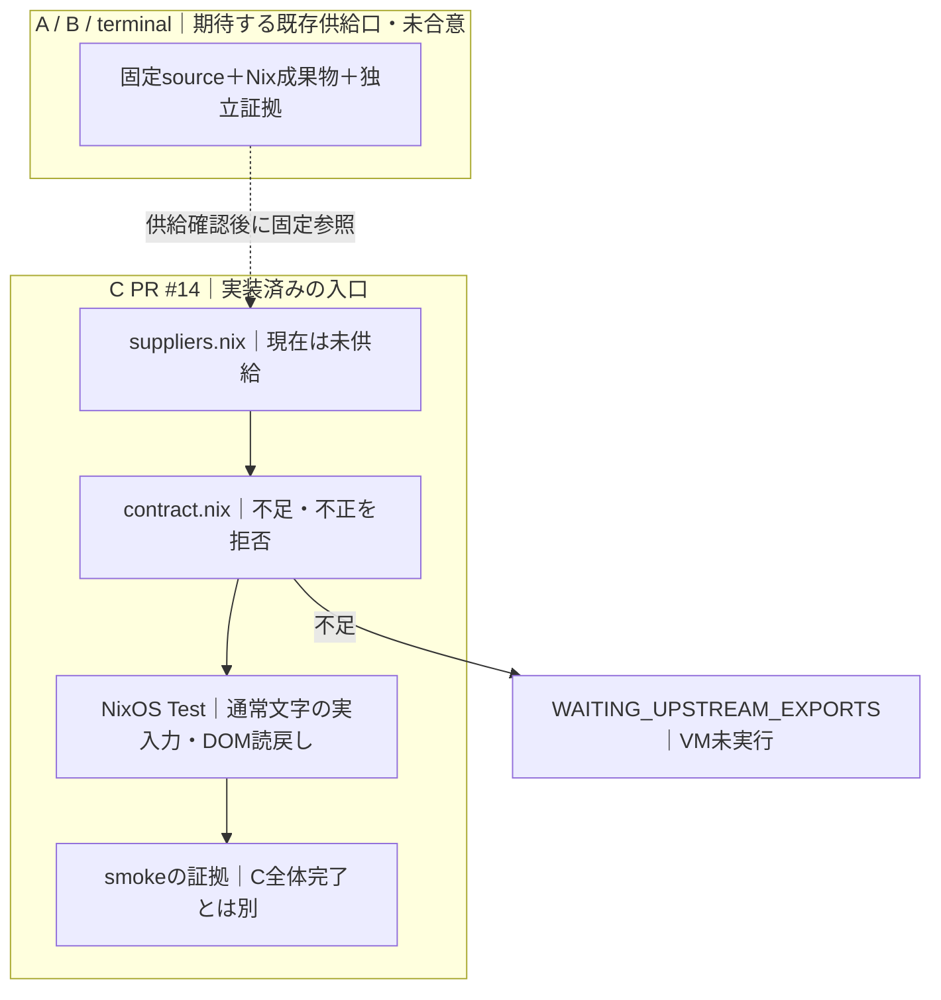

# Browser/Input結合 — tty-split-20261013-v1 / C

## 目的

A（Chrome ↔ cdp-tty）とB（bcon ↔ Meltype ↔ Shell/Editor）を独立完成させ、
最後に同じ候補版setで bcon → Meltype → cdp-tty → 既存Chrome Target を結合する。
Xという中間製品、別のBrowser/Profile、追加の変換器・runnerは作らない。

A: [ops #534](https://github.com/roccho-org/ops/pull/534)
B: [Meltype #3](https://github.com/roccho-dev/Meltype/pull/3)
結合の移行元: [resources #3](https://github.com/roccho-dev/resources/pull/3)、
[Meltype #2](https://github.com/roccho-dev/Meltype/pull/2)。
設計はadrs #615/#618を参照し、正式採択や元条件の置換をこの文書だけで行わない。

## 受入の受渡し

| 旧要件/証拠 | 新しい所有と扱い |
|---|---|
| Meltype #2の実Native/候補/子PTY/TTY復旧 | Bの単独証拠をexact版で受け取る。CでCoreを複製しない |
| cdp-ttyの表示/入力/継続・旧ops #433反例 | Aが単独完成。Cはその同版を消費し、Meltype修正でViewer不具合を隠さない |
| bcon → Meltype → cdp-tty → 同じTargetの日本語DOM | Cの実入力受入。直接DOM書換えや試験側insertTextで代用しない |
| typed候補表示/選択/確定 → DOM | Cの実入力受入。元ID/型/選択をBの証拠と照合し、表示差分だけで確定成功にしない |
| resources #3のE01〜E12 | 本結合が担う部分との対応を残す。残りのHost契約を自動closeしない |

## 移設前の保全

旧Meltype #2の `d673872560f7e6b3b20fed1452f6949c55c722f1` と旧resources #3の
`8f3ef91df8e33b6188f970d302d8dd4baeb6fee8` は移行元であり、変更済み新成果と混同しない。
C側の実試験・CI入口・証拠出力・旧要件対応が成立するまで、旧結合試験を削除/skip/弱化しない。
移設先が未完成の間もA/Bの独立作業は進める。個別合格だけで全体DONEにはしない。

## 結合受入

- A/Bの候補版commit/tree、実artifact hash、bcon/OS/試験版を固定し、同じ組を実行する。
- 実bconの画面とキーから、通常日本語および型付き候補を同じChrome Target/入力欄へ確定し、DOMを別経路で読戻す。
- 候補画像とBrowser画像の共存、誤入力先/二重確定/古い応答の拒否、resize、再接続、終了、端末復旧を検査する。
- Viewer終了後もChrome PID/Target/Profileを保持。秘密・利用者の本番Profileを試験へ使わない。
- 失敗は境界前後の実値と版を残し、原因コードの所有先A/Bへ返す。Cが他repoの製品コードをコピー修正しない。
- 実物理端末・実Provider・独立Rなど、必要な証拠が欠ければ未達を残す。VM/fixtureを昇格させない。
- A/B各mergeとCの全体合格は別。Cのmergeには固定候補版set全体の合格・独立reviewを要求する。

初期commit c93d194は結合責務・移設条件の固定だけ。実試験の移設・再実行・全体完成は未完了。
本PRは新規恒久OS設定、本番配備、既存PRのmerge/close、担当/権限変更を行わない。

## C側実装と期待契約（2026-10-13）

Related: [ADRS #630のNix更新案](https://github.com/roccho-dev/adrs/issues/630#issuecomment-6139949993)、
[resources #1の所有範囲](https://github.com/roccho-dev/resources/issues/1#issuecomment-6139963822)。
いずれも参考・未採択の関係参照。Nixの試験用入力固定を製品依存の第二正本にせず、
Host/Relationの意味、運用上の版選択、依存更新の一操作化をここで採択しない。

**以下はCが期待する供給口であり、A/Bの同意・実装・受入済みの主張ではない。**
A/Bへ変更を加えず、現時点のsuppliers.nixはすべてnullとする。新しい共通export schemaは作らず、
確認できた既存Nix出力をC側の3引数へ対応付ける。出力名や梱包方式を一律に強制しない。

| 相手 | Cからの期待 | まだ主張しないこと |
|---|---|---|
| A / ops #534 | 固定source rev/NAR hashに対応したNix derivation。bin/cdp-ttyがTTYを受け、明示した既存Page WebSocketへattachする。入力結果不明を自動再送しない | Aの受諾、独立合格、全キー互換 |
| B / Meltype #3 | 同じく固定sourceとNix derivation。bin/meltype-ttyがCore/NativeAOT/Mozc/フォントを自身の依存として解決。既知本文向け--raw-textと--以後の子argvを扱う | Bの受諾、再現ビルド完成、任意の秘密欄やcaretの安全性 |
| 既存terminal Producer | 固定版のbin/bconとKitty/VT/仮想物理キーに必要な依存 | 新しいbconビルド定義のCへの移管 |
| A/Bの独立証拠 | 上記source/成果物と一致する実試験・残件・独立review参照 | derivationの形やhashが一致するだけで独立合格 |

供給が確認できた時点でsuppliers.nixに既存出力を固定参照する。各値はC専用の
`package / rev / narHash`。revとnarHashは**source**識別であり、配布バイナリhashではない。
実行証拠にはさらにdrvPath・outPathと実行入口のSHA-256を残す。宣言値とProducer証拠の
対応確認・信頼性評価は独立受入の仕事であり、構造検査だけで証明したとはしない。

### 実行面と偽陽性の拒否

verification/tty-browser-join/contract.nixが不足・不正な供給を検査し、default.nixは
供給不足ならnixpkgsの取得やVM起動より前に失敗する。ローカルZIP/path、浮動branch、
hash欠落、異なる実行system、余分なX入力を受理しない。構造が正しくても返す状態は
INPUT_SHAPE_VALID_NOT_E2Eであり、合意・信用・品質・C合格を意味しない。

VMのpackage setは既存nixos/flake.lockのnixpkgsだけを再利用し、own-OCI/windows入力や
恒久Host設定は評価・変更しない。A/BのProducer lockを統一し直すことやCでの再梱包はしない。

CIのintake-unit-onlyは合成値による16反証/正常例のみ。ordinary-input-smoke-not-closureは
実供給がなければSKIPや代用品にせず失敗する。テスト用合成値はVMに渡さない。
Nix/KVMがない環境で実行済みとは報告しない。

### 今回の試験範囲と残るC1〜C7

旧Meltype #2の通常文字→実bcon→cdp-tty→DOMと同相termios復元の試験方式を移設。
VMの実キーだけで文字を入力し、別CDP接続は読取式のみ。候補画面・未確定時のDOM不変・
確定後の文字・同じTarget・Browser PID保持・Viewer終了・TTY復元を検査する。
これは通常文字のsmoke用実装であり、まだ実A/Bによる実行はしていない。

型付き候補の全経路、元IDの実選択照合、stale/二重確定/誤対象/切断/再接続/resize、
実Provider、物理端末、独立R、および旧E01〜E12との全対応は未完了。
旧試験は削除・skipしない。このsmokeが将来成功してもC1〜C7の合格にはしない。
本番配備・共通更新engine・依存更新UX・ADRS採択・mergeは今回の実装に含めない。
