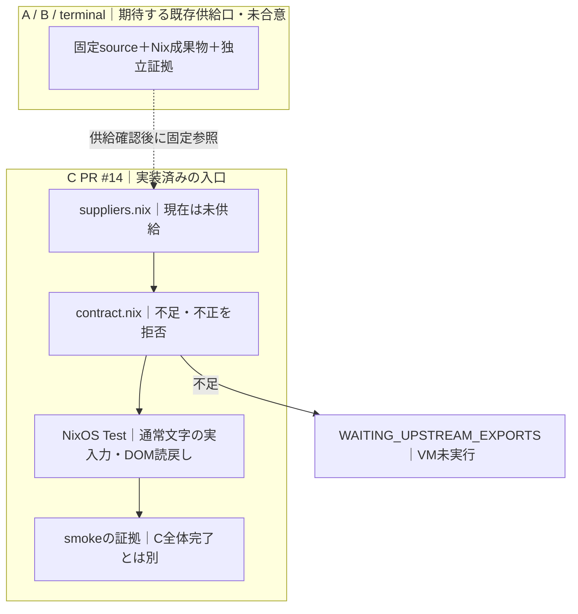
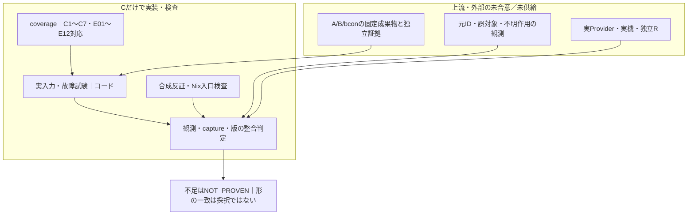

# Browser/Input結合 — tty-split-20261013-v1 / C

## 現在のbase整列（0e1の有限成功後）

0e1のA d5a/B1c4/terminal cfeによる同版結合は
[39116044270](https://github.com/roccho-dev/resources/actions/runs/39116044270)で77Python/19Nix、
16VM＋unknown-effect、保存/upload/re-download/verifyまでSUCCESS。intake12132252557と
smoke12132927247（SHA256 1b1496e74bcdfbc7be98e7453ca5b82624b3ecd810396d02eb28c8ce350e4d2b）、
35参照/33file・15trial両保存先・132埋込bytesを自読した。17CONSISTENT/8NOT_PROVENは維持する。

統合直前の実proposalsは `ee37c36ba469bcc5842dd41a722acd088fe8368c` へ進み、
PR45のproduction Meltype1.2.1.9/48fd source+ZIPと、PR46の固定TypeLLM launcher追加がある。
両方を保全し、common mkLaunchのcompile-time auth.keyと当方のbounded reference fd4を合成した。
Jev既定、元query/期限/上限、固定Apps/proposer/semcmp、fd閉鎖を緩めず、
新TypeLLM鍵/許可/実呼出しをこのtaskへ借用しない。新しい実Provider呼出しは0。
非作成者が旧/現/上流を同条件の実Nix parse・生成textで比較し、Jev既定の作用差は
fields sortのLC_ALL=C固定だけ、鍵/FD/query/期限/上限/子envの生成値不変を確認した。
各生成shellとproof.shのbash -nは0。これはsyntax/semantic対応でありrealbuildや新Jev評価ではない。
親reference環境をTypeLLMへ注入する反例を追加し、通常fixtureの元closed-env/stdio判定を維持した。

Cの13code/pins/A/B/terminal、host-nixpkgs node、実入力/期待値/観測/timeoutは不変だが、
共通launcherの生成物対応と新baseの通常試験・保存・独立判定は別に実確認する。
0e1成功だけでこの新統合版を合格にせず、当該版のCIへ接続する。

0e1のgeneric own117641960396は、旧production console3cf6/v1.2.1.8・bcon575cの
raw command ready待ち30.57sでFAILした。final joinの1c4/ca30とは別bindingである。
basec936の117632720285及び同0e1の並行sourceVM117641925282は、厳密同一console drv
`5f1rgyfzv8k3rmlhg6bljv9yspmqwn4d` で元DI2全期待値までSUCCESS。
この一失敗を消さず、原因・入力到達/失敗画面未回収の範囲を残す。再Enter/無変更retry/
timeout延長/skip化でGreenにしていない。新しいproduction bindingの結果も別判定する。

以下は各時点のfinite履歴であり、現在の新sourceの合格へ自動転用しない。

## 2026-10-18の最終結合候補（Cの実行結果は別判定）

現候補はA canonical `d5a669d976d4e0d6ddf9903ca534b7ae2539b8e2`、
B canonical `1c4f3460546653bf097ed161f2e997d9f7f766b6`、
terminal `cfe7483db1658d299965c608a07f17f973fd79f7`。
Bは実main `48fd707d793cf0046ccb87b37ad429823576d8c1` までの並行変更を統合した版である。
通常Linux producer [39114830964](https://github.com/roccho-dev/Meltype/actions/runs/39114830964)
はsource/同package各216単体、実Native26/typed14、CLI、Apps8eのcontrolled source/session、
実bcon Shell/Editor/paste/resize/reference・先頭行のpassive preview、供給保存までSUCCESS。
runtime `12131737436`、receipt `12132361527`、VM `12132585684` の実bytes/digest、
元commit/tree/run・内ZIP・4製品hashをroot/subがそれぞれ実照合した。
B独立 [5562386777](https://github.com/roccho-dev/Meltype/pull/28#pullrequestreview-5562386777)
をrootが全文読戻し、B自身の元条件を確認後、同一commitをmainへ非force統合した。
PR28 merged_at 2026-10-18T09:36:19Z/main=1c4をAPI確認。canonical通常pushの結果は別に読戻す。
source/package NARは同producerの保存実測値を既存receiverへ渡し、C/Windowsで代替計算しない。

先行C `bb928ba756f17787dd45fbfb0148218c5d912760` /
[39112570459](https://github.com/roccho-dev/resources/actions/runs/39112570459) はA d5a/B776dで
77Python/19Nix、通常16VM＋unknown-effect、保存/re-download/verifyまでSUCCESS。
source `12130584759` とsmoke `12130983168`、元ID/世代/実DOM/TTY/Profile・全参照hashを
root/subが読戻した。17 CONSISTENT/8 NOT_PROVEN・admission NOT_PERFORMEDを維持し、
この先行成功を新しいB1c4 setの成功やC7へ流用しない。

旧C `9a821468d1391ac976a2177e76f957e2d0632411` / run `39107428810` はA d5a/B c51で
cancel-after-finish exit1、画像ACK断片の入力混入を記録してFAILした。fault `12128649033`
を保持する。Bの元期限内のACK所有・binding失効是正は有限反例と実Nativeで確認したが、
旧f7の唯一因果・一般安定を確定しない。C6712/B a86、C2d909797/B c51も各有限履歴である。

今回のC差分は実proposals `c936e2f6dc9760a8f4471f286eae551215ba1236` の非競合統合と
同producer tupleのpins/説明である。別scopeで採用されたrelease-watch設定・own-completion記録を
保全し、その運用GOをABCへ借用しない。A/terminal、実入力、期待値、観測条件、待ち時間、
結合workflow/helper、描画・判定器は変えない。既存の二重ZIP/hash/NAR照合、
root flake.lockのhost-nixpkgs参照、Bの明示 --compose、16VM＋unknown-effect、
保存/re-download/verifyと独立C1〜C7判定を維持する。

既存実利用launcherのcode/鍵fd・allowlist・固定Apps/proposer/semcmp/Git・endpoint境界は
C9aからbyte不変。元許可内の私的原記録をJevへ渡した実2呼出しはB776dで完了した有限証拠であり、
失敗前の未送信bootstrapとも区別する。B1c4の変更済み実Nativeでは元応答JSON値をそのまま使う
network-none互換確認（追加実呼出し0）を実施した。元ID/意味/表現/evidence/順序、
旧応答作用0・現応答143bytes一回の実子readを照合し、表示画像も元証拠とのbyte対応で確認した。
これとCの同版binary/bridge/mode/encoding/targetの実DOM経路を独立に結び、fixtureだけで
実Provider合格としない。期限・上限を延長して新しい実呼出しを行わない。
このpins更新や先行成功だけでは新set成功・C7・最終mergeを主張しない。

## 目的

A（Chrome ↔ cdp-tty）とB（bcon ↔ Meltype ↔ Shell/Editor）を独立完成させ、
最後に同じ候補版setで bcon → Meltype → cdp-tty → 既存Chrome Target を結合する。
Xという中間製品、別のBrowser/Profile、追加の変換器・runnerは作らない。

A: [ops #534](https://github.com/roccho-org/ops/pull/534)
B: [Meltype #3](https://github.com/roccho-dev/Meltype/pull/3)
結合の移行元: [resources #3](https://github.com/roccho-dev/resources/pull/3)、
[Meltype #2](https://github.com/roccho-dev/Meltype/pull/2)。
設計はadrs #615/#618を参照し、正式採択や元条件の置換をこの文書だけで行わない。

## 受入の受渡し

| 旧要件/証拠 | 新しい所有と扱い |
|---|---|
| Meltype #2の実Native/候補/子PTY/TTY復旧 | Bの単独証拠をexact版で受け取る。CでCoreを複製しない |
| cdp-ttyの表示/入力/継続・旧ops #433反例 | Aが単独完成。Cはその同版を消費し、Meltype修正でViewer不具合を隠さない |
| bcon → Meltype → cdp-tty → 同じTargetの日本語DOM | Cの実入力受入。直接DOM書換えや試験側insertTextで代用しない |
| typed候補表示/選択/確定 → DOM | Cの実入力受入。元ID/型/選択をBの証拠と照合し、表示差分だけで確定成功にしない |
| resources #3のE01〜E12 | 本結合が担う部分との対応を残す。残りのHost契約を自動closeしない |

## 移設前の保全

旧Meltype #2の `d673872560f7e6b3b20fed1452f6949c55c722f1` と旧resources #3の
`8f3ef91df8e33b6188f970d302d8dd4baeb6fee8` は移行元であり、変更済み新成果と混同しない。
C側の実試験・CI入口・証拠出力・旧要件対応が成立するまで、旧結合試験を削除/skip/弱化しない。
移設先が未完成の間もA/Bの独立作業は進める。個別合格だけで全体DONEにはしない。

## 結合受入

- A/Bの候補版commit/tree、実artifact hash、bcon/OS/試験版を固定し、同じ組を実行する。
- 実bconの画面とキーから、通常日本語および型付き候補を同じChrome Target/入力欄へ確定し、DOMを別経路で読戻す。
- 候補画像とBrowser画像の共存、誤入力先/二重確定/古い応答の拒否、resize、再接続、終了、端末復旧を検査する。
- Viewer終了後もChrome PID/Target/Profileを保持。秘密・利用者の本番Profileを試験へ使わない。
- 失敗は境界前後の実値と版を残し、原因コードの所有先A/Bへ返す。Cが他repoの製品コードをコピー修正しない。
- 実物理端末・実Provider・独立Rなど、必要な証拠が欠ければ未達を残す。VM/fixtureを昇格させない。
- A/B各mergeとCの全体合格は別。Cのmergeには固定候補版set全体の合格・独立reviewを要求する。

初期commit c93d194は結合責務・移設条件の固定だけ。実試験の移設・再実行・全体完成は未完了。
本PRは新規恒久OS設定、本番配備、既存PRのmerge/close、担当/権限変更を行わない。

## 初回C側実装と期待契約（2026-10-13 / b4a7be3）

Related: [ADRS #630のNix更新案](https://github.com/roccho-dev/adrs/issues/630#issuecomment-6139949993)、
[resources #1の所有範囲](https://github.com/roccho-dev/resources/issues/1#issuecomment-6139963822)。
いずれも参考・未採択の関係参照。Nixの試験用入力固定を製品依存の第二正本にせず、
Host/Relationの意味、運用上の版選択、依存更新の一操作化をここで採択しない。

**以下はCが期待する供給口であり、A/Bの同意・実装・受入済みの主張ではない。**
A/Bへ変更を加えず、現時点のsuppliers.nixはすべてnullとする。新しい共通export schemaは作らず、
確認できた既存Nix出力をC側の3引数へ対応付ける。出力名や梱包方式を一律に強制しない。

| 相手 | Cからの期待 | まだ主張しないこと |
|---|---|---|
| A / ops #534 | 固定source rev/NAR hashに対応したNix derivation。bin/cdp-ttyがTTYを受け、明示した既存Page WebSocketへattachする。入力結果不明を自動再送しない | Aの受諾、独立合格、全キー互換 |
| B / Meltype #3 | 同じく固定sourceとNix derivation。bin/meltype-ttyがCore/NativeAOT/Mozc/フォントを自身の依存として解決。既知本文向け--raw-textと--以後の子argvを扱う | Bの受諾、再現ビルド完成、任意の秘密欄やcaretの安全性 |
| 既存terminal Producer | 固定版のbin/bconとKitty/VT/仮想物理キーに必要な依存 | 新しいbconビルド定義のCへの移管 |
| A/Bの独立証拠 | 上記source/成果物と一致する実試験・残件・独立review参照 | derivationの形やhashが一致するだけで独立合格 |

供給が確認できた時点でsuppliers.nixに既存出力を固定参照する。各値はC専用の
`package / rev / narHash`。revとnarHashは**source**識別であり、配布バイナリhashではない。
実行証拠にはさらにdrvPath・outPathと実行入口のSHA-256を残す。宣言値とProducer証拠の
対応確認・信頼性評価は独立受入の仕事であり、構造検査だけで証明したとはしない。

### 実行面と偽陽性の拒否

verification/tty-browser-join/contract.nixが不足・不正な供給を検査し、default.nixは
供給不足ならnixpkgsの取得やVM起動より前に失敗する。ローカルZIP/path、浮動branch、
hash欠落、異なる実行system、余分なX入力を受理しない。構造が正しくても返す状態は
INPUT_SHAPE_VALID_NOT_E2Eであり、合意・信用・品質・C合格を意味しない。

VMのpackage setは既存root flake.lockのhost-nixpkgsだけを再利用し、own-OCI/windows入力や
恒久Host設定は評価・変更しない。A/BのProducer lockを統一し直すことやCでの再梱包はしない。

CIのintake-unit-onlyは合成値による16反証/正常例のみ。ordinary-input-smoke-not-closureは
実供給がなければSKIPや代用品にせず失敗する。テスト用合成値はVMに渡さない。
Nix/KVMがない環境で実行済みとは報告しない。

### 初回の試験範囲と残るC1〜C7

旧Meltype #2の通常文字→実bcon→cdp-tty→DOMと同相termios復元の試験方式を移設。
VMの実キーだけで文字を入力し、別CDP接続は読取式のみ。候補画面・未確定時のDOM不変・
確定後の文字・同じTarget・Browser PID保持・Viewer終了・TTY復元を検査する。
これは通常文字のsmoke用実装であり、まだ実A/Bによる実行はしていない。

型付き候補の全経路、元IDの実選択照合、stale/二重確定/誤対象/切断/再接続/resize、
実Provider、物理端末、独立R、および旧E01〜E12との全対応は未完了。
旧試験は削除・skipしない。このsmokeが将来成功してもC1〜C7の合格にはしない。
本番配備・共通更新engine・依存更新UX・ADRS採択・mergeは今回の実装に含めない。

## C単独継続：入力・反証・証拠整合（上流供給は未設定のまま）

Userの `continue to loop to done` に基づくC限定の継続。A/Bや既存Host・lockは変更しない。
既存[Host側のacceptance.py](https://github.com/roccho-dev/resources/blob/8f3ef91df8e33b6188f970d302d8dd4baeb6fee8/verification/acceptance.py)
と同じく「証拠の整合性」と「独立採否」を分離する。Cの新判定はCの観測値用であり、
E01〜E12の判定器を複製・置換しない。新runnerや更新engineも作らない。

### 追加実装

| Cの実体 | 責務・限界 |
|---|---|
| coverage.json | C1〜C7と25観測項目、旧E01〜E12の対応・残るHost担当を一か所で列挙。旧要件は削除しない |
| evidence.py | 文脈・実DOM値・元ID/型・世代・候補取消・復旧・capture/hashを照合。欠損・重複・skip・別版・自己review・fixture昇格を拒否。結果はCONSISTENTであり採択ではない |
| fixture.py | VM内loopbackの有限試験用Provider。通常候補、遅延応答、JSON不正、重複ID、操作型、制御文字、raw不一致を生成。実Shared Providerの代用ではない |
| observer.py | 固定入力欄を読取CDPで観測し、Bの子PTYとViewerの寿命を読む。DOM書換え・試験側insertText・キーの直接配送はしない |
| test.py / test.nix | 実キーから通常/型付き確定・取消・古い応答・不正候補・二重確認・resize・Viewer再attach・TCP切断・TTY/Profile継続を試す。実供給でのVM実行は別証拠 |
| test_unit.py / test-contract.nix | 合成観測の反証、純粋な判定、loopback HTTP fixture、部分供給を遅延評価で拒否する試験。VM証拠には使わない |

構造検査は18件（初回16件＋部分供給/余分入力でpackageを評価しない2件）。
Python単体試験の件数と結果は同じheadのCIログを正本とする。CIはPR更新に一本化し、
以前のpush＋pull_request二重発火を避ける。既存の2 job名とread-only権限は維持する。

### A/Bへ期待するが、同意済みとしない観測

- **Bの実選択元ID/型/世代/raw/一度だけ確定**：表示文字から元IDを逆算しない。
  `typed-id` の照合器はあるが、実CLIから副作用なく取得する供給口は未合意。
  表示とDOMが一致しても `typed-id` はNOT_PROVENのまま。
- **誤Target/入力欄の拒否と不明な作用の再送0**：子PTYの一致だけを任意caretの保証にしない。
  `wrong-target` の不変DOM判定と `unknown-effect` の独立証拠受入口はあるが、
  実製品の観測・故障注入の対応は未合意。TCP切断成功だけで不明作用の再送0へ拡張しない。
- 独立A/B/terminal合格、完全な旧試験移管、実Provider、物理端末、実機同等性、独立Rは
  各所有者からの対応する証拠が必要。Cが代筆して合意・合格・観測済みにしない。

これらは**C側の期待の主張**。共通export schemaを要求せず、実在する供給口に対応付ける。
未取得の観測を空やPASSで埋めず、実VMが成功しても不足項目をassessment.jsonに残す。

### 証拠と判定の使い方

Nix固定入力とCコードのhash、実行環境のhashを `context.json` に記録する。
`raws.jsonl` の各観測は同じcontextと `capture-<case>.json` の内容・hashに結び、
関連する最終画面のPNGも保存する。判定結果は `assessment.json`、未達は
`disruptives.jsonl`。Nix失敗時もJSON観測と最後の試験画面1枚を既存CIログへ残す。

`evidence.py` は `--expected` / `--records` / `--root` を受け取り、整合時0、不整合時1。
JSONキー重複・NaN・過大入力・参照先逸脱・symlink・capture差替えは拒否する。
入力が全て整合しても `C_EVIDENCE_CONSISTENCY_ONLY / admission=NOT_PERFORMED`。
自己申告hash・参照URL・異なるreviewer名だけでは信頼・独立性の実在を証明できない。
必要な収集元の確認・採否は従来のC7独立Rに残す。

実行方式の参照：NixOS Manual「Writing Tests」、Chrome DevTools Protocol
Runtime.evaluate（throwOnSideEffect）、iproute2 ss(8) の -K。
接続切断はkernelが閉じたsocketを実際に返した場合だけ試験し、未対応の黙示skipを合格にしない。
この試験コードはA/B契約未供給の間は未実証。旧Red/旧試験を消さず、C mergeと本番applyも行わない。
