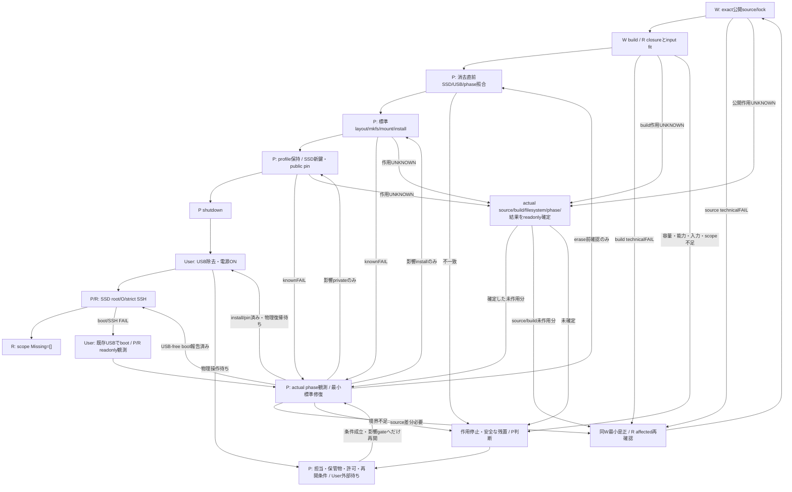
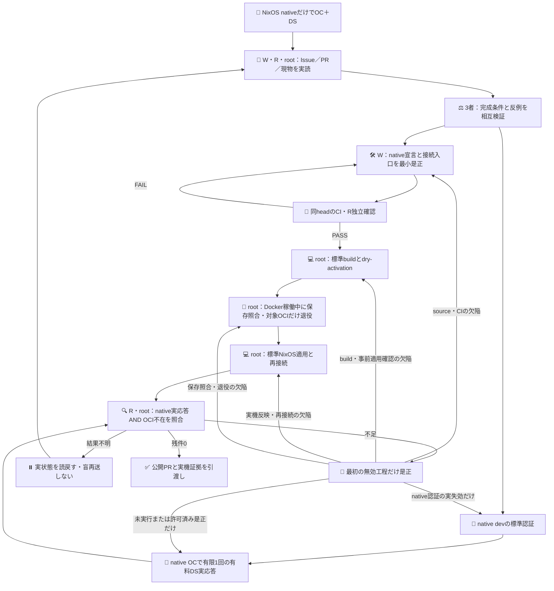

# VersaPro SSD bootstrap

このscopeは、既存の[検証済みUSB](./versapro-usb-installer.md)から、内蔵SSDをNixOSだけで起動する最小構成へ進むもの。Userは対象SSDの上書きを許可済み。ソース公開・第一system build・独立Rの消去前受入を先に済ませ、SSD/runtime作用はPだけが行う。現在はソース候補で、SSD installとUSB-free bootは未実証。

## 最小構成

```text
resources/
├── flake.nix                    # rootのversapro output、標準source revision
├── flake.lock                   # 実Nix生成。host-nixpkgs 2efa67…を固定
└── nixos/
    ├── versapro.nix             # BIOS/GRUB、SSD root、NM、公開管理鍵SSH
    └── versapro-installer.nix    # 既存USB宣言。変更/import/再buildしない

resources/docs/versapro-ssd-install.md   # 現scope・消去前gate・有限復旧工程

内蔵SSD / MBR
├── 最初の1MiB                  # GRUB embedding領域。filesystemを置かない
└── partition 1 / ext4          # label NIXOS_ROOT、残り容量、swapなし
    ├── /boot/                   # BIOS GRUB、kernel/initrd。同じroot filesystem内
    ├── /nix/store/              # 非秘密のOS closure
    ├── /etc/NetworkManager/system-connections/<profile>
    │                            # 既live profileからPがon-target配置。root:root/0600
    └── /etc/ssh/ssh_host_ed25519_key
                                 # SSD上で新生成/保持。USB鍵をコピーしない
```

GRUBの対象はwhole disk `/dev/disk/by-id/ata-SSD_240G_1804BQ0831CWM370`。観測はSSD 240G / serial 1804BQ0831CWM370 / 240,057,409,536 bytes。boot rootはunique label `NIXOS_ROOT` のext4。BIOSかつ223.6GiBなので、MBR単一partitionで足りる。GPT用bios_grub/ESP、swap、disko、agent/Mesh/sops frameworkを追加しない。

```text
D = (公開exact source revision, 実flake.lock, 観測hardwareとの適合)
O = Build(D)                       # 第一system/toplevelと実closure
Install(O, 対象SSD, P_private)       # Pの標準nixos-install、秘密はstore外
SSD受入 = SourceBuildPASS ∧ ActualSSDIdentity ∧ StandardInstallPASS
        ∧ PersistentWifiAndNewTargetKey ∧ UsbFreeBiosBoot
        ∧ CurrentSystemEqualsO ∧ StrictPermanentPinSSH ∧ (TargetLinuxInput=0)

P_private ↛ Git / flake inputs / Nix store / argv / public logs
```

source/lockだけでhardware適合・有効認証・USB-free bootを保証しない。固定nixpkgsはUSBと同じ既知revisionだが、installerのlive moduleやbootstrap mountはSSD systemへimportしない。

## 消去前のsource/build gate

初回SSD scopeは4つの新text filesを専用resources PRで扱った。現行の提供版ではroot flakeへ統合済みであり、下記のroot入口とその公開head/tree・lockを一組で選択する。入口の更新だけで既存USB/Windows/Browser Host/OCIや実SSDへ作用しない。公開head/treeと標準Nix lock/eval/build入力を結び、構成の推測や構文成功だけをerase根拠にしない。

標準build locatorは `github:roccho-dev/resources/<actual-public-head>#nixosConfigurations.versapro.config.system.build.toplevel`。既存strict USB SSHから非秘密のlock/eval/buildだけを行う。tmpfs free、RAM、AC、必要substitute/download/build量を確認し、現live storeに収まる余裕がなければbuildを進めずPへ境界を返す。第一toplevelを実生成し、実derivation/output/closure量とGRUB/root/initrd/NM/sshd仕様を独立Rが確認する。新helper・別builder・秘密input・全agent packageは不要。

旧版の固定commitが提供していた `?dir=nixos` と、root統合後の版を混ぜない。既存の採択版・実機状態はこの文書の修正では変わらない。新版の取得入口・検証結果は [提供契約](./windows-migration-preparation.md) と [PR31](https://github.com/roccho-dev/resources/pull/31) で確認する。標準CIの `versapro-native-host` は同じ `versapro` のtoplevelを検査する。入口とその検査対象の一致をCIで確認するが、実SSDの適合・消去前独立受入・USB-free bootの代用にはしない。

### 有限受入表

| Gate | 実確認する入力/条件 | 担当 |
|---|---|---|
| S source | actual PR base/head/tree、選択版のsource差分・root lock、root label/whole-SSD GRUB、5実initrd modules、SSH公開鍵/private境界 | W作成、R独立 |
| B build | exact公開input→first drv/output、closure/store fit、AC/RAM、compiled boot/NM/SSH。完了前erase 0 | W標準build、R独立 |
| D erase直前 | by-idが実SSDへresolve、model/serial/bytes一致、USB除外、NTFS未mount、現在phase/権限/accepted O | P作用、R独立 |
| I install | MBR/1MiB/単一ext4、標準install exitとSSD root/boot配置、USB/source保全 | P作用、R独立 |
| K private | profile root600、SSD新host鍵metadata、trusted live経由のpublic pinだけ、USB鍵copy 0 | P作用、R独立 |
| G boot | shutdown後Userがboot USBを外してON。SSD root/boot、actual O/source revision、Wi-Fi/NM/sshd、恒久pin strict SSH、手元Linux入力0 | User物理、P/R |
| T terminal | open/attached PRとactual install/boot evidence、全scope Missing=[]。物理待ちは未完checkpoint | R、P報告 |

## 標準install工程

Pは各作用直前に対象identityと現在phaseを照合する。実layout/boot/closureが受入済みであることを確認し、対象SSDだけを標準parted/sfdiskでMBR・先頭1MiB gap・単一Linux partitionへ整え、ext4 label `NIXOS_ROOT` を作成して `/mnt` へmountする。起動中のUSBが供給するISO/store/bootstrapは抜去・上書きしない。

受入済みstore outputを `O` として、標準 `nixos-install --root /mnt --system O --no-channel-copy --no-root-password`（同義 `--no-root-passwd`）を使う。受入後に別sourceから暗黙rebuildしない。必要な公開flake/configとclosureをSSDへ保持する。

Wi-Fiは既live runtime profileからSSDの標準NetworkManager slotへ、Pのon-target file操作だけでroot:root/0600配置する。SSID/PSKやprofile bodyを表示・Git/storeへ渡さない。SSDのhost鍵はtarget filesystem上で標準ssh-keygenを用い新生成し、既存があれば上書きせずactual phaseを調べる。秘密鍵をG6I3へ移送せず、public keyだけをtrusted USB SSH経由で取得し、USB identityとは別の恒久host pinを保護されたclient slotへ保持する。

標準shutdownの後、Userがboot USBを外して電源ON。既存管理鍵の公開鍵authだけで入り、USB-free SSD起動を実確認する。新sourceのbuild PASSをboot PASSにしない。失敗時はUSBの既存strict identityを保持した復旧入口へ戻り、原因確定前の盲目repartitionや鍵再生成をしない。

## 失敗・停止・再開



外部条件の成功保証ではない。物理待ちはinstall済み/USB依存の安全な状態と再開担当を残し、DONEへ迂回しない。既にUserが許可した対象SSD eraseの再確認や全Windows backupを余計なgateにしない。通常のknownFAILと作用UNKNOWNを区別し、修復は観測された影響分だけ。

常設後のNixOS内部進化、通常rebuild/回線復帰、auth/work/agent保持、Mesh、VPS評価は[先行設計](https://github.com/roccho-dev/windows/issues/69#issuecomment-6074206950)の別scope。今回の最小SSD boot受入・source PRを、それらの完成やmerge/Issue closeへ広げない。


## Native-only development and OCI retirement (2026-10-20)

The current target is the physical VersaPro NixOS host, reached through `versapro-ssd`.
Tools execute as native `dev` through the existing Core and independently selected
`/nix/var/nix/profiles/own-dev` generation introduced by [PR80](https://github.com/roccho-dev/resources/pull/80).
The host declaration no longer imports an OCI module, starts Docker, or exports the retired
VersaPro OCI module. Its storage, management SSH identity, native user and physical console remain intact.
Windows own/rent OCI implementations and the isolated historical OCI regression VM remain separate.

[Issue72's explicit native-only decision](https://github.com/roccho-dev/resources/issues/72#issuecomment-6276509736)
supersedes that issue body's older future-only wording for this target. The former
[Issue10](https://github.com/roccho-dev/resources/issues/10) describes an OCI goal: retiring it does not
complete that goal. This change does not complete the broader HQ/G6I3 migration in Issue72 or all of Issue61.

| Evidence | What it proves | What it does not prove |
|---|---|---|
| `versapro-native-boundary` | Canonical host has no Docker/OCI declaration and retains native user/profile entry | Current machine activation or authenticated inference |
| `versapro-native-host` | Exact host system builds from the declared root output | Actual SSH reconnection, target identity or runtime application |
| `own-native-profile-vm` | Actual selector accepts a native NixOS VM and refuses detected/unknown containers before build/set | Real target credentials or provider response |
| Historical `own-oci-vm` | Isolated OCI regression only | NixOS native execution, auth or success |
| Native OpenCode version/auth catalog | Installed tool and current authentication metadata | Model inference or a date-specific backend |
| Native SSH/runuser dev launch chain, native binary and owned session plus one real paid DS response | That native attempt, selected provider alias, response and reported usage | A live child PID/mount-namespace snapshot (not captured); a 1017 backend unless provider attests it; other hosts or OCI |

OCI responses, container PATHs, forwarded ports, HTTP 200 and copied authentication cannot satisfy
native acceptance. Normal provider login belongs to the actual native user; no credential is copied
from a container. The existing native profile selector refuses a non-NixOS runtime, a detected
container, a missing detector or an unknown detector result before any build/profile mutation.
A genuine NixOS VM is permitted for source tests and is labelled VM evidence.
The mocked detector tests prove the entrypoint branches only; actual OCI refusal is a separate
pre-retirement observation and is never inferred from the fixture.

### Finite closure



Source changes/CI, actual host activation, OCI retirement and paid inference are distinct effects.
A source PR does not authorize merge. Root performs only the separately authorized live retirement
and standard host application; W authors source and R independently evaluates it. Work must first be
pushed/checkpointed and the requested DS-state copy retained. Delete only the identified VersaPro OCI
container and its exact three volumes after preservation; never run a broad Docker prune or touch
Windows OCI. Authentication and transient servers need not be migrated. Known technical failures
return to the affected stage; unknown effects are observed before any repeat. Authentication/provider
waiting does not block unrelated secret-free source work. Final acceptance requires the actual native SSH/runuser-dev launch chain, native binary and
owned session/event readback, the finite response and reported usage, retired unit/container/port absence,
and independent readback after reconnection. No live child PID/mount-namespace snapshot was captured;
the observed native launch chain and owned session do not substitute for that missing snapshot, and it
does not justify a repeated paid call. Retire the target container/volumes while Docker still runs after
standard build/dry-activation inspection; then activate the native-only system and reconnect. Activation
stops Docker, so cleanup must not depend on starting the retired daemon again. Until the remaining live
observations exist, they remain unproven.
